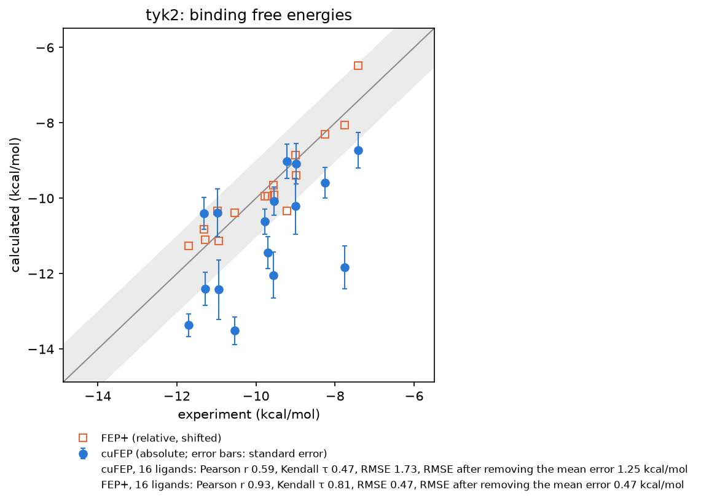
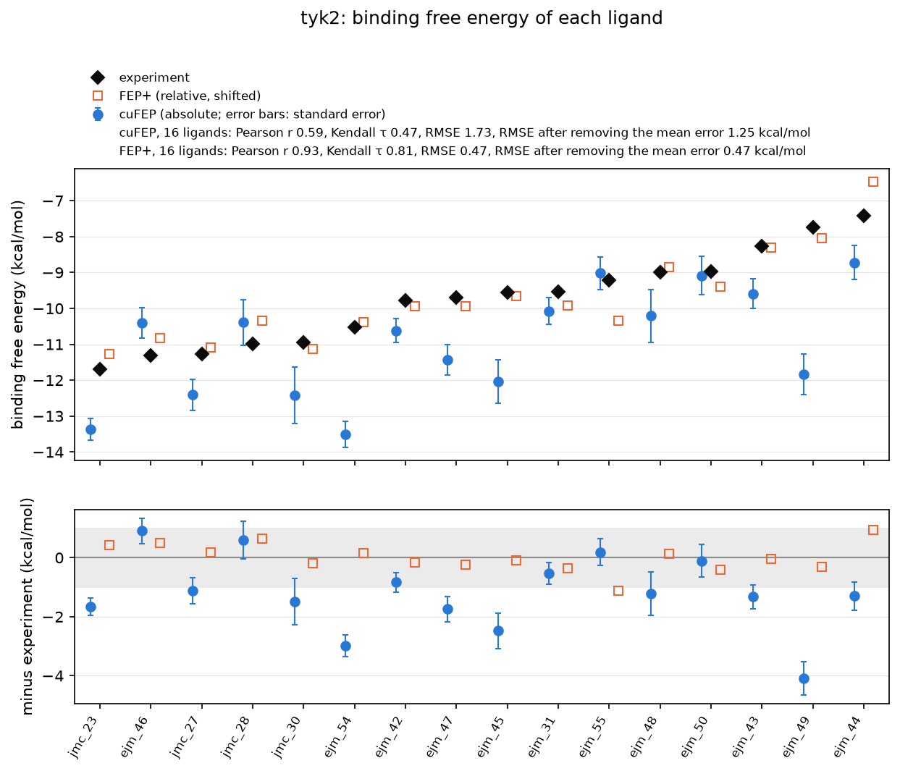
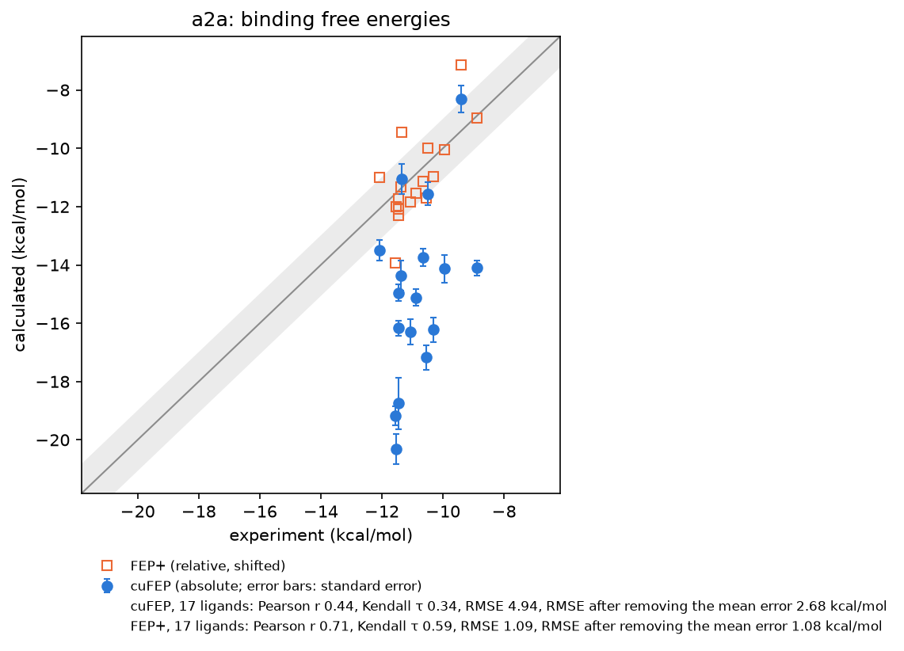
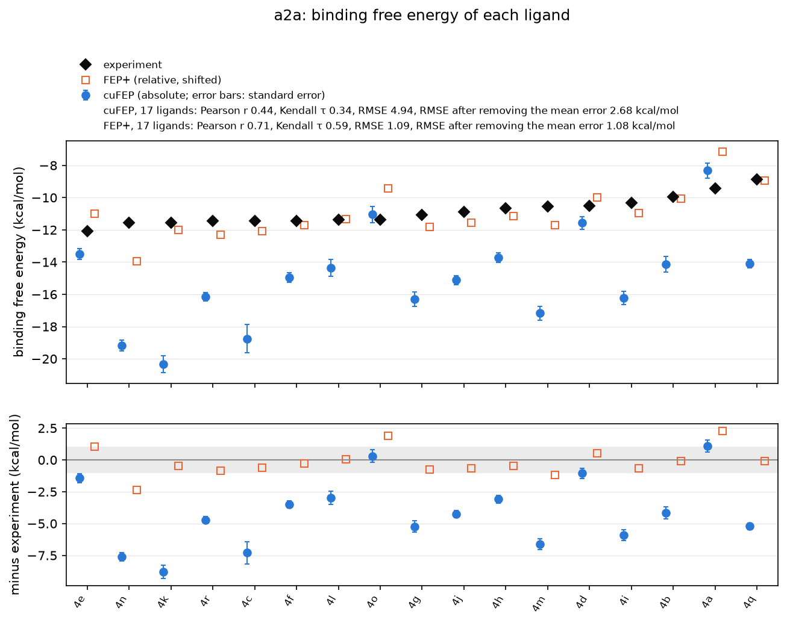

# cuFEP の精度: 実験値と FEP+ との比較

[English](https://github.com/ytworks/cuFEP/wiki/Accuracy)

このページは、cuFEP の絶対結合自由エネルギーが実験値にどれだけ近いかを、同じベンチマークセットと
ともに公開されている FEP+ の予測値と並べて示します。数値はすべて、各セット全体を 1 回ずつ計算した
結果で、リポジトリの [benchmarks/results](https://github.com/ytworks/cuFEP/tree/main/benchmarks/results)
に記録しています。計算の後で除外、再計算、調整をしたものはありません。解析のチェックを通らなかった
リガンドも、ほかのリガンドと同じように比較し、印を付けています。このページは数値を示すもので、
判定は示しません。

- [要約](#要約)
- [計算したもの](#計算したもの)
- [参照データ](#参照データ)
- [比較の読み方](#比較の読み方)
- [TYK2](#tyk2)
- [A2A](#a2a)
- [別の ABFE 手法 Felis との比較](#別の-abfe-手法-felis-との比較)
- [前回の計算との比較](#前回の計算との比較)
- [この結果から言えないこと](#この結果から言えないこと)
- [結果の再現](#結果の再現)
- [出典](#出典)

## 要約

TYK2 (16 リガンド) と A2A (17 化合物) の全セットを、リガンドごとに 1 回、lambda window あたり
5 ns の production で計算しました。下の統計量は 3 つの手法とも Felis 論文の定義で同じように計算した
ものです ([Felis との比較](#別の-abfe-手法-felis-との比較)。kcal/mol、オフセット b =
⟨実験値 − 予測値⟩)。FEP+ の値は公開セットの実験値の平均に全体としてそろえてあるため、そのオフセットは
作り方からほぼ 0 で、2 つの絶対値の手法のオフセットとは比べられません:

| セット | 手法 | R² | Spearman ρ | Kendall τ | オフセット b | 補正後 RMSE |
|---|---|---|---|---|---|---|
| TYK2 (16) | cuFEP、5 ns × 1 回 | 0.35 | 0.65 | 0.47 | 1.20 | 1.25 |
| TYK2 (16) | Felis、5 ns × 3 回 | 0.69 | 0.82 | 0.68 | 0.04 | 0.82 |
| TYK2 (16) | FEP+ | 0.86 | 0.93 | 0.81 | 0.00 | 0.47 |
| A2A (17) | cuFEP、5 ns × 1 回 | 0.19 | 0.43 | 0.34 | 4.14 | 2.68 |
| A2A (17) | Felis、5 ns × 3 回 | 0.55 | 0.81 | 0.65 | 2.74 | 1.16 |
| A2A (17) | FEP+ | 0.50 | 0.73 | 0.59 | 0.16 | 1.08 |

- どちらのセットでも、cuFEP は FEP+ と Felis よりリガンドの順位の当たり方が低く、オフセットを除いた
  誤差も大きくなっています。
- cuFEP の予測は実験値より、TYK2 で平均 1.20 kcal/mol、A2A で 4.14 強く結合する側にずれています。
  Felis は 0.04 と 2.74 です。
- 66 の leg すべてが adaptive lambda scheduling で計算され (complex leg は 30 の lambda window から
  始め、隣り合う 2 window だけの overlap を基準 0.30 で読む。solvent leg は stage の overlap 行列を
  基準 0.18 で読む)、NOT RELIABLE の結果はありません。TYK2 の 16 リガンド中 12、A2A の 17 化合物中
  14 で、ある leg に独立サンプルが 50 未満の lambda window があります。
- 両セットを以前の既定値で 1 回ずつ計算した結果を、[前回の計算との比較](#前回の計算との比較) で
  今回と並べています。リガンドごとの 2 回の差は TYK2 で -3.76〜+2.27 kcal/mol、A2A で
  -4.78〜+5.41 で、1 回の計算の標準誤差は 0.26〜1.02 です。

## 計算したもの

cuFEP バージョン 0.1 のコミット `e77a6c5` (pull request #7 をマージした後の `main`) を、そのコミット
から作った Docker イメージで、GPU 8 枚の 1 台のマシンで 2026 年 11 月 22 日に実行しました。計算
バックエンドは NVIDIA の OpenMM 用 cuPotential プラグインです (66 の leg すべてがこれで動きました)。
各セットは、その example の設定
([examples/kinase_tyk2/config.yaml](https://github.com/ytworks/cuFEP/blob/main/examples/kinase_tyk2/config.yaml)、
[examples/membrane_a2a/config.yaml](https://github.com/ytworks/cuFEP/blob/main/examples/membrane_a2a/config.yaml))
で、リガンドごとに 1 回計算しました。すべての設定とその根拠は
[docs/configuration.md](https://github.com/ytworks/cuFEP/blob/main/docs/configuration.md)、手法は
[docs/protocol.md](https://github.com/ytworks/cuFEP/blob/main/docs/protocol.md) にあります。

| 設定 | 値 |
|---|---|
| 手法 | double decoupling による絶対結合自由エネルギー。Boresch 拘束、アンカー原子は複合体の拘束なしの MD でのタンパク質とリガンドの相互作用から選択 (`restraints.selection: interactions`、既定値。入力のポーズから 3 ns の MD を 4 本、それぞれの最後の 2 ns を解析、800 フレーム) |
| 力場 | ff14SB (タンパク質)、TIP3P (水)、OpenFF 2.2.1 と AM1-BCC 電荷 (リガンド)、Lipid21 の POPC (A2A の二重膜) |
| 条件 | 298.15 K、1 bar、イオン強度 0.15 M。時間刻み 4 fs、水素質量再分配 (3 amu) |
| アルケミカル計算の前 | complex leg は NVT 0.25 ns、NPT 0.5 ns、MD 5 ns。solvent leg は 0.1、0.2、0.5 ns。A2A は二重膜の平衡化 10 ns |
| lambda window | adaptive lambda scheduling (Midgley ら 2025)。complex leg は 30 window (restrain 6、discharge 11、vanish 15) から始め、隣り合う 2 window だけの overlap が 0.30 以下の所に window を足す。solvent leg は 5・9 window から、stage の overlap 行列で基準 0.18。いずれも既定値 |
| サンプリング | Hamiltonian レプリカ交換、1 iteration 2.5 ps。リガンドと、その 0.4 nm 以内の残基に REST2、scale 1.5 |
| lambda window あたり | 平衡化 1 ns と production 5 ns (cuFEP の既定は 10 ns。example とベンチマークは 5 ns を設定) |
| 解析 | MBAR から長距離分散補正を引いた値。標準誤差は時間ブロックから求め、解析的な値を下回らない (ブロックが作れないほどサンプルが少ないときは解析的な値)。解析のバージョン 10 |

## 参照データ

セットは Schrödinger の公開結合自由エネルギーベンチマーク (Ross ら 2023、MIT ライセンス) のもので、
cuFEP はその入力ファイルを変更せずに使います
([benchmarks/README.md](https://github.com/ytworks/cuFEP/blob/main/benchmarks/README.md))。

| セット | 標的 | リガンド | 実験値の範囲 (kcal/mol) | セットの出典 |
|---|---|---|---|---|
| `tyk2` (`jacs_set/tyk2`) | TYK2 キナーゼ (PDB 4GIH)、水中 | 16 | -11.70 〜 -7.42 (4.28) | doi:10.1021/ja512751q |
| `a2a` (`gpcrs/a2a_hip278`) | アデノシン A2A 受容体 (PDB 5OLZ)、POPC 二重膜中 | 17 化合物 | -12.07 〜 -8.89 (3.19) | doi:10.1021/acs.jcim.0c00449 |

- 実験値: セットとともに与えられた各リガンドの実験の結合自由エネルギー (SDF の `r_exp_dg`。FEP+ の
  結果ファイルの `Exp. dG` と同じ)。
- FEP+: セットとともに公開されている FEP+ の結果ファイルの `Pred. dG` (`tyk2_out.csv`。A2A は
  `a2a_hip278_sbpkacorr_out.csv`)。摂動のマップ上の相対計算から得た値を、公開セットの実験値の平均に
  全体としてそろえたものです。公開された値をそのまま使い、このページのために FEP+ を実行しては
  いません。
- リガンドの状態: TYK2 は化合物ごとに中性のレコードが 1 つです。A2A の元データは 17 化合物に 29 の
  レコード (回転異性体、鏡像異性体、脱プロトン化体) を持ちます。cuFEP 0.1 は中性のリガンドだけを
  扱い、使ったのは FEP+ の結果ファイルが報告するレコードで、どの化合物でも中性です
  ([benchmarks/a2a/ligands.csv](https://github.com/ytworks/cuFEP/blob/main/benchmarks/a2a/ligands.csv))。

## 比較の読み方

- cuFEP は絶対結合自由エネルギーを計算し、FEP+ の値は相対値を実験値の平均にそろえたものです。この
  ため cuFEP の生の平均符号誤差、RMSE、MUE には全値に共通のずれが含まれ、FEP+ のそれはそろえたこと
  で共通のずれが除かれています (公開セット全体では FEP+ の平均符号誤差は 0。ここでのリガンドだけ
  では 0 とは限らない)。この 3 行は同じ条件の比較ではありません。2 つの手法を同じ条件で比べるのは、
  それぞれの平均誤差を除いた RMSE、ペアワイズ ddG RMSE、Kendall τ、Spearman ρ、Pearson r、Pearson R² です。
- かっこ内の値は、リガンドについての 95 % ブートストラップ区間 (再標本 2000 回) です。16 と 17 の
  リガンドでは区間は広くなります。
- cuFEP の値の誤差棒は、その 1 回の計算の標準誤差で、すべての lambda window に共通の時間ブロック
  から求め、解析的な値を下回りません。ブロックが作れないほどサンプルが少ない leg では解析的な値です
  (TYK2 の 16 リガンド中 1、A2A の 17 化合物中 8)。同じ complex leg を繰り返し計算した値どうしは、この標準誤差より大きく違ったことが
  あります ([protocol: REST2](https://github.com/ytworks/cuFEP/blob/main/docs/protocol.md#rest2))。
  誤差棒は、2 回目の計算がどれだけ違いうるかを小さく見せます。
- すべての leg に、文献の 2 つのチェックをします。NOT RELIABLE: 隣り合う 2 つの lambda window の
  overlap が 0.03 未満 (Klimovich ら 2015)。few independent samples: ある lambda window が MBAR に
  渡す相関のない標本が 50 未満 (Mey ら 2020)。結果のあるリガンドはすべて、NOT RELIABLE のものも
  含めて統計に入れています。NOT RELIABLE のものは図で白抜きの丸で描き、2 つ目の表でそれ以外の
  リガンドと分けて比較します。

## TYK2

16 リガンドすべてに結合自由エネルギーがあります。NOT RELIABLE のリガンドはありません:
隣り合う lambda window の overlap の最小値は 0.140〜0.172 です。16 のうち 12 では、ある leg に独立
サンプルが 50 未満の lambda window があります (complex leg 11、solvent leg 4。最も少ないのは
ejm_48、ejm_46、ejm_45 の complex leg の 11、12、14)。adaptive lambda scheduling は complex leg の
30 window に 1〜6 を足し (31〜36 window)、solvent leg に 3〜8 を足しました (16〜21)。拘束はすべて、
リガンドと VAL 981 の主鎖との水素結合から選ばれました (解析した 800 フレーム中 736〜782 で存在)。





全 16 リガンドの統計 (kcal/mol。かっこ内は 95 % ブートストラップ区間):

| 統計量 | cuFEP | FEP+ |
|---|---|---|
| 平均符号誤差 (kcal/mol) | -1.20 [-1.83, -0.60] | 0.00 [-0.23, 0.23] |
| RMSE、生 (kcal/mol) | 1.73 [1.10, 2.30] | 0.47 [0.29, 0.65] |
| MUE、生 (kcal/mol) | 1.41 [0.94, 1.93] | 0.37 [0.24, 0.53] |
| 平均誤差を除いた RMSE (kcal/mol) | 1.25 [0.75, 1.62] | 0.47 [0.28, 0.63] |
| ペアワイズ ddG RMSE (kcal/mol) | 1.83 [1.10, 2.36] | 0.69 [0.41, 0.92] |
| Kendall τ | 0.47 [0.12, 0.75] | 0.81 [0.61, 0.96] |
| Spearman ρ | 0.65 [0.19, 0.90] | 0.93 [0.75, 0.99] |
| Pearson r | 0.59 [0.15, 0.87] | 0.93 [0.85, 0.98] |
| Pearson R² | 0.35 [0.03, 0.75] | 0.86 [0.73, 0.96] |

NOT RELIABLE のリガンドがないので、分けて比べる 2 つ目の群はありません。

すべてのリガンド (kcal/mol。adaptive scheduling の後の complex leg と solvent leg の lambda window
の数。チェックのフラグ):

| リガンド | 実験値 | cuFEP | 標準誤差 | cuFEP − 実験値 | FEP+ | FEP+ − 実験値 | 窓 complex / solvent | 最小 overlap | フラグ |
|---|---|---|---|---|---|---|---|---|---|
| jmc_23 | -11.70 | -13.36 | 0.30 | -1.66 | -11.27 | +0.43 | 32 / 19 | 0.172 |  |
| ejm_46 | -11.31 | -10.40 | 0.43 | +0.91 | -10.82 | +0.49 | 33 / 17 | 0.153 | few independent samples: complex leg |
| jmc_27 | -11.28 | -12.41 | 0.43 | -1.13 | -11.10 | +0.18 | 33 / 17 | 0.140 | few independent samples: complex leg, solvent leg |
| jmc_28 | -10.98 | -10.39 | 0.63 | +0.59 | -10.34 | +0.64 | 33 / 19 | 0.144 |  |
| jmc_30 | -10.94 | -12.42 | 0.79 | -1.48 | -11.13 | -0.19 | 35 / 17 | 0.159 | few independent samples: complex leg, solvent leg |
| ejm_54 | -10.53 | -13.51 | 0.37 | -2.98 | -10.38 | +0.15 | 34 / 21 | 0.143 | few independent samples: complex leg |
| ejm_42 | -9.78 | -10.62 | 0.34 | -0.84 | -9.95 | -0.17 | 33 / 16 | 0.155 |  |
| ejm_47 | -9.70 | -11.44 | 0.43 | -1.74 | -9.94 | -0.24 | 35 / 17 | 0.146 |  |
| ejm_45 | -9.56 | -12.04 | 0.61 | -2.48 | -9.66 | -0.10 | 33 / 19 | 0.155 | few independent samples: complex leg |
| ejm_31 | -9.54 | -10.08 | 0.37 | -0.54 | -9.91 | -0.37 | 33 / 18 | 0.154 | few independent samples: complex leg |
| ejm_55 | -9.21 | -9.02 | 0.45 | +0.19 | -10.34 | -1.13 | 31 / 19 | 0.153 | few independent samples: complex leg |
| ejm_48 | -9.00 | -10.21 | 0.74 | -1.21 | -8.86 | +0.14 | 34 / 17 | 0.157 | few independent samples: complex leg |
| ejm_50 | -8.98 | -9.08 | 0.54 | -0.10 | -9.40 | -0.42 | 33 / 18 | 0.162 | few independent samples: solvent leg |
| ejm_43 | -8.26 | -9.59 | 0.41 | -1.33 | -8.30 | -0.04 | 35 / 18 | 0.149 | few independent samples: complex leg, solvent leg |
| ejm_49 | -7.75 | -11.84 | 0.57 | -4.09 | -8.05 | -0.30 | 36 / 18 | 0.155 | few independent samples: complex leg |
| ejm_44 | -7.42 | -8.72 | 0.47 | -1.30 | -6.48 | +0.94 | 34 / 17 | 0.153 | few independent samples: complex leg |

数値から言えること (判定ではありません):

- 16 リガンドのうち 13 が実験値より強く結合する側に出ています。平均符号誤差は -1.20 kcal/mol です。
- ずれが最も大きいのは ejm_49 (-4.09)、ejm_54 (-2.98)、ejm_45 (-2.48)、ejm_47 (-1.74)、
  jmc_23 (-1.66) です。
- example のリガンド ejm_31 は、ここでは -10.08 ± 0.37 kcal/mol でした。この計算の前に同じ設定で
  3 回計算した値は -9.36、-9.63、-9.33 でした (標準偏差 0.17。
  [protocol: What was measured on TYK2](https://github.com/ytworks/cuFEP/blob/main/docs/protocol.md#what-was-measured-on-tyk2))。

## A2A

17 化合物すべてに結合自由エネルギーがあります。NOT RELIABLE の化合物はありません: 隣り合う
lambda window の overlap の最小値は 0.105〜0.169 で、4i の 0.105 が最も低い値です。17 のうち 14 で、
complex leg に独立サンプルが 50 未満の lambda window があり、4 化合物では 14 未満です (4q 4、4e 5、
4c 12、4i 13)。solvent leg にはありません。adaptive lambda scheduling は complex leg の 30 window に
0〜2 を足し (30〜32 window。7 つの complex leg は 30 のまま)、solvent leg に 3〜7 を足しました
(16〜20)。拘束は、11 化合物で ASN 253 との水素結合、5 化合物 (4e、4h、4i、4j、4o) で PHE 168 との
スタッキング、1 化合物 (4m) で GLU 169 との水素結合から選ばれました (解析した 800 フレーム中
737〜797 で存在)。





全 17 化合物の統計 (kcal/mol。かっこ内は 95 % ブートストラップ区間):

| 統計量 | cuFEP | FEP+ |
|---|---|---|
| 平均符号誤差 (kcal/mol) | -4.14 [-5.36, -2.85] | -0.16 [-0.68, 0.36] |
| RMSE、生 (kcal/mol) | 4.94 [3.82, 5.89] | 1.09 [0.68, 1.43] |
| MUE、生 (kcal/mol) | 4.31 [3.20, 5.40] | 0.84 [0.53, 1.18] |
| 平均誤差を除いた RMSE (kcal/mol) | 2.68 [1.76, 3.24] | 1.08 [0.58, 1.40] |
| ペアワイズ ddG RMSE (kcal/mol) | 3.91 [2.56, 4.72] | 1.58 [0.85, 2.05] |
| Kendall τ | 0.34 [-0.03, 0.67] | 0.59 [0.28, 0.86] |
| Spearman ρ | 0.43 [-0.07, 0.82] | 0.73 [0.35, 0.95] |
| Pearson r | 0.44 [-0.02, 0.77] | 0.71 [0.28, 0.90] |
| Pearson R² | 0.19 [0.00, 0.60] | 0.50 [0.08, 0.81] |

NOT RELIABLE の化合物がないので、分けて比べる 2 つ目の群はありません。

すべての化合物 (kcal/mol。adaptive scheduling の後の complex leg と solvent leg の lambda window の
数。チェックのフラグ):

| リガンド | 実験値 | cuFEP | 標準誤差 | cuFEP − 実験値 | FEP+ | FEP+ − 実験値 | 窓 complex / solvent | 最小 overlap | フラグ |
|---|---|---|---|---|---|---|---|---|---|
| 4e | -12.07 | -13.50 | 0.34 | -1.43 | -11.01 | +1.06 | 30 / 17 | 0.169 | few independent samples: complex leg |
| 4n | -11.55 | -19.17 | 0.33 | -7.62 | -13.93 | -2.38 | 31 / 17 | 0.147 | few independent samples: complex leg |
| 4k | -11.54 | -20.32 | 0.52 | -8.78 | -12.00 | -0.46 | 31 / 18 | 0.148 | few independent samples: complex leg |
| 4r | -11.46 | -16.17 | 0.26 | -4.70 | -12.31 | -0.85 | 31 / 17 | 0.151 |  |
| 4c | -11.46 | -18.75 | 0.88 | -7.29 | -12.09 | -0.63 | 30 / 17 | 0.145 | few independent samples: complex leg |
| 4f | -11.45 | -14.96 | 0.29 | -3.51 | -11.72 | -0.27 | 32 / 18 | 0.160 | few independent samples: complex leg |
| 4l | -11.38 | -14.37 | 0.52 | -2.99 | -11.32 | +0.06 | 31 / 20 | 0.150 | few independent samples: complex leg |
| 4o | -11.36 | -11.05 | 0.51 | +0.31 | -9.44 | +1.92 | 31 / 19 | 0.158 | few independent samples: complex leg |
| 4g | -11.06 | -16.30 | 0.45 | -5.23 | -11.83 | -0.77 | 30 / 18 | 0.147 | few independent samples: complex leg |
| 4j | -10.89 | -15.12 | 0.28 | -4.23 | -11.54 | -0.65 | 31 / 17 | 0.150 | few independent samples: complex leg |
| 4h | -10.65 | -13.74 | 0.30 | -3.08 | -11.13 | -0.48 | 30 / 16 | 0.145 |  |
| 4m | -10.55 | -17.17 | 0.42 | -6.62 | -11.71 | -1.16 | 31 / 19 | 0.152 | few independent samples: complex leg |
| 4d | -10.51 | -11.56 | 0.39 | -1.06 | -9.98 | +0.53 | 31 / 18 | 0.145 | few independent samples: complex leg |
| 4i | -10.31 | -16.22 | 0.41 | -5.91 | -10.97 | -0.66 | 30 / 17 | 0.105 | few independent samples: complex leg |
| 4b | -9.96 | -14.13 | 0.47 | -4.17 | -10.06 | -0.10 | 30 / 18 | 0.145 |  |
| 4a | -9.41 | -8.32 | 0.46 | +1.09 | -7.15 | +2.26 | 31 / 18 | 0.142 | few independent samples: complex leg |
| 4q | -8.89 | -14.11 | 0.27 | -5.22 | -8.96 | -0.07 | 30 / 18 | 0.151 | few independent samples: complex leg |

数値から言えること (判定ではありません):

- 17 化合物のうち 15 が実験値より強く結合する側に出ています。17 化合物全体の平均符号誤差は
  -4.14 kcal/mol です。Felis の論文も、この標的について同じ向きのオフセット 2.74 を報告しています。
- ずれが最も大きいのは 4k (-8.78)、4n (-7.62)、4c (-7.29)、4m (-6.62)、4i (-5.91) です。
- example のリガンド 4e は、ここでは -13.50 ± 0.34 kcal/mol でした (complex leg 39.76、solvent leg
  16.54)。以前の版で 1 回ずつ計算した値は、拘束を `restraints.selection: auto` で選んだとき -18.91 と
  -11.95、`interactions` で拘束用の MD の始め方が違うとき -12.14、-16.85、-15.47 でした。
- 二重膜の 10 ns の平衡化の最後の 2 つの四半分の間で、面積は -2.2〜+0.6 %、リガンド近くの水の数は
  -0.3〜+0.8 変化しています (17 の complex leg)。

## 別の ABFE 手法 Felis との比較

Felis (ByteDance Seed) は OpenMM で絶対結合自由エネルギーを計算する手法で、同じ公開セットで評価
されています (Ding ら、arXiv:2603.22274、2026 年 11 月 9 日の版 3)。リガンドごとの値は公開されて
いないため、比較は標的ごとに、その論文の定義による統計量で行います: R² (Pearson)、Spearman ρ、
Kendall τ、オフセット b = ⟨実験値 − 予測値⟩、b だけずらした予測値の RMSE と MAE、実験値の差が
2 kcal/mol を超えるペアのうち順序が正しいものの割合。cuFEP と FEP+ の行はこの定義でここで計算した
ものです。公開されている FEP+ の予測値にこの定義を当てはめると、両標的とも論文の FEP+ の行と
一致します。Felis の行は論文から写したものです。

| | cuFEP (このページ) | Felis (論文) |
|---|---|---|
| リガンドあたりの計算 | 1 回 | 3 回の平均 |
| λ 状態の数、complex / solvent | adaptive: TYK2 31-36 / 16-21、A2A 30-32 / 16-20 | 中性リガンドで 80 / 24 (電荷のあるリガンドは 96 / 32) |
| Boresch 拘束 | 複合体の拘束なしの 3 ns の MD 4 本でのタンパク質とリガンドの相互作用からアンカー原子を選ぶ (Felis の論文 2.1 節の規則) | 複合体の拘束なしの 3 ns の MD 4 本でのタンパク質とリガンドの相互作用からアンカー原子を選ぶ |
| 状態あたりのサンプリング | 平衡化 1 ns の後 5 ns | 5 ns (またはその最初の 3 ns)、破棄なし |
| 拡張サンプリング | Hamiltonian レプリカ交換、ポケットに REST2 | Hamiltonian レプリカ交換、リガンド近くの水に RelocationMC |
| リガンドの力場 | OpenFF 2.2.1、AM1-BCC | ByteFF25、AM1-BCC (または ABCG2) |
| 推定法 | MBAR | 隣り合う状態間の BAR |
| リガンドの状態 | 化合物ごとに 1 レコード: A2A は FEP+ の結果ファイルが報告する中性のレコード (29 レコード中 17) | ベンチマークのすべてのレコード (別の結合ポーズとプロトン化状態、857 エントリーで 998 配置) を計算し、化合物ごとに対称性と pKa/互変異性の補正で 1 つにまとめる |
| 結晶水 | 入力にあるもの。ここで使った TYK2 と A2A のタンパク質ファイルには水がない | ベンチマークのリポジトリにあるものをそのまま残す |
| A2A の環境 | cuFEP が作る POPC 二重膜に受容体を入れる | 論文に記載がない |

TYK2:

| 手法 | リガンド | R² | Spearman ρ | Kendall τ | オフセット b | 補正後 RMSE | 補正後 MAE | 順序正解率 |
|---|---|---|---|---|---|---|---|---|
| cuFEP、この計算 (5 ns × 1 回) | 16 | 0.35 | 0.65 | 0.47 | 1.20 | 1.25 | 0.94 | 0.91 |
| FEP+、公開予測値からここで計算 | 16 | 0.86 | 0.93 | 0.81 | 0.00 | 0.47 | 0.37 | 1.00 |
| Felis、5 ns × 3 回、ByteFF25 AM1-BCC |  | 0.69 | 0.82 | 0.68 | 0.04 | 0.82 | 0.56 | 0.97 |
| Felis、3 ns × 3 回、ByteFF25 AM1-BCC |  | 0.64 | 0.83 | 0.67 | 0.23 | 0.89 | 0.64 | 0.97 |
| Felis、5 ns × 3 回、ByteFF25 ABCG2 |  | 0.39 | 0.66 | 0.48 | 0.09 | 1.06 | 0.76 | 0.91 |
| FEP+ (論文の表の値) |  | 0.86 | 0.93 | 0.81 | 0.00 | 0.47 | 0.37 | 1.00 |

A2A:

| 手法 | リガンド | R² | Spearman ρ | Kendall τ | オフセット b | 補正後 RMSE | 補正後 MAE | 順序正解率 |
|---|---|---|---|---|---|---|---|---|
| cuFEP、この計算 (5 ns × 1 回) | 17 | 0.19 | 0.43 | 0.34 | 4.14 | 2.68 | 2.16 | 0.81 |
| FEP+、公開予測値からここで計算 | 17 | 0.50 | 0.73 | 0.59 | 0.16 | 1.08 | 0.79 | 1.00 |
| Felis、5 ns × 3 回、ByteFF25 AM1-BCC |  | 0.55 | 0.81 | 0.65 | 2.74 | 1.16 | 0.88 | 1.00 |
| Felis、3 ns × 3 回、ByteFF25 AM1-BCC |  | 0.53 | 0.75 | 0.57 | 2.98 | 1.20 | 0.92 | 1.00 |
| Felis、5 ns × 3 回、ByteFF25 ABCG2 |  | 0.57 | 0.87 | 0.72 | 2.04 | 1.07 | 0.75 | 0.94 |
| FEP+ (論文の表の値) |  | 0.50 | 0.73 | 0.59 | 0.16 | 1.08 | 0.79 | 1.00 |

## 前回の計算との比較

両セットは以前にも 1 回ずつ、コミット `3b45bfe` で計算しています (pull request #4。その記録:
[コミット cda6965 の benchmarks/results](https://github.com/ytworks/cuFEP/tree/cda6965/benchmarks/results))。
2 つのコミットの間で cuFEP のコードは変わっています。2 回の計算の記録された設定
(`resolved_config.yaml`) の違いは、次の表のものだけです:

| 設定 | 前回 (3b45bfe) | 今回 (e77a6c5) |
|---|---|---|
| Boresch 拘束、`restraints.selection` | `auto`: アンカー原子を pre-equilibration から選ぶ | `interactions`: アンカー原子を複合体の拘束なしの MD でのタンパク質とリガンドの相互作用から選ぶ |
| complex leg の adaptive lambda scheduling | 3・5・9 window から。stage の overlap 行列で基準 0.18 | 30 window から。隣り合う 2 window だけの overlap で基準 0.30 |
| lambda window の数の上限、complex / solvent | 48 / 32 | 100 / 100 |

complex leg の lambda window は、前回は TYK2 で 20〜30、A2A で 17〜21、今回は 31〜36 と 30〜32 に
なりました。上限に達した leg はありません。

両方の計算の統計量 (Felis の論文の定義、kcal/mol):

| セット | 計算 | R² | Spearman ρ | Kendall τ | オフセット b | 補正後 RMSE | 補正後 MAE | 順序正解率 |
|---|---|---|---|---|---|---|---|---|
| TYK2 (16) | 今回 (e77a6c5) | 0.35 | 0.65 | 0.47 | 1.20 | 1.25 | 0.94 | 0.91 |
| TYK2 (16) | 前回 (3b45bfe) | 0.19 | 0.21 | 0.12 | 0.62 | 1.74 | 1.49 | 0.68 |
| A2A (17) | 今回 (e77a6c5) | 0.19 | 0.43 | 0.34 | 4.14 | 2.68 | 2.16 | 0.81 |
| A2A (17) | 前回 (3b45bfe) | 0.15 | 0.48 | 0.38 | 4.12 | 2.26 | 1.79 | 0.94 |

両方の計算でのすべてのリガンド (kcal/mol。標準誤差はその 1 回の計算のもの):

TYK2 (16):

| リガンド | 実験値 | 今回 | 標準誤差 | 前回 | 標準誤差 | 今回 − 前回 |
|---|---|---|---|---|---|---|
| jmc_23 | -11.70 | -13.36 | 0.30 | -9.60 | 0.37 | -3.76 |
| ejm_46 | -11.31 | -10.40 | 0.43 | -11.26 | 0.48 | +0.86 |
| jmc_27 | -11.28 | -12.41 | 0.43 | -9.48 | 0.52 | -2.92 |
| jmc_28 | -10.98 | -10.39 | 0.63 | -9.76 | 0.33 | -0.63 |
| jmc_30 | -10.94 | -12.42 | 0.79 | -14.69 | 0.91 | +2.27 |
| ejm_54 | -10.53 | -13.51 | 0.37 | -12.47 | 0.57 | -1.04 |
| ejm_42 | -9.78 | -10.62 | 0.34 | -11.97 | 0.41 | +1.35 |
| ejm_47 | -9.70 | -11.44 | 0.43 | -9.41 | 0.31 | -2.03 |
| ejm_45 | -9.56 | -12.04 | 0.61 | -10.43 | 0.48 | -1.61 |
| ejm_31 | -9.54 | -10.08 | 0.37 | -9.84 | 0.33 | -0.24 |
| ejm_55 | -9.21 | -9.02 | 0.45 | -10.23 | 0.46 | +1.21 |
| ejm_48 | -9.00 | -10.21 | 0.74 | -10.72 | 0.36 | +0.51 |
| ejm_50 | -8.98 | -9.08 | 0.54 | -11.04 | 0.54 | +1.96 |
| ejm_43 | -8.26 | -9.59 | 0.41 | -8.21 | 0.41 | -1.38 |
| ejm_49 | -7.75 | -11.84 | 0.57 | -11.07 | 0.60 | -0.77 |
| ejm_44 | -7.42 | -8.72 | 0.47 | -5.73 | 0.36 | -2.99 |

A2A (17):

| リガンド | 実験値 | 今回 | 標準誤差 | 前回 | 標準誤差 | 今回 − 前回 |
|---|---|---|---|---|---|---|
| 4e | -12.07 | -13.50 | 0.34 | -18.91 | 0.52 | +5.41 |
| 4n | -11.55 | -19.17 | 0.33 | -18.50 | 0.65 | -0.67 |
| 4k | -11.54 | -20.32 | 0.52 | -15.54 | 0.34 | -4.78 |
| 4r | -11.46 | -16.17 | 0.26 | -16.43 | 0.63 | +0.26 |
| 4c | -11.46 | -18.75 | 0.88 | -15.14 | 0.72 | -3.61 |
| 4f | -11.45 | -14.96 | 0.29 | -14.52 | 0.38 | -0.43 |
| 4l | -11.38 | -14.37 | 0.52 | -13.82 | 0.65 | -0.55 |
| 4o | -11.36 | -11.05 | 0.51 | -10.19 | 0.85 | -0.86 |
| 4g | -11.06 | -16.30 | 0.45 | -13.57 | 0.69 | -2.72 |
| 4j | -10.89 | -15.12 | 0.28 | -14.63 | 0.47 | -0.49 |
| 4h | -10.65 | -13.74 | 0.30 | -18.36 | 1.02 | +4.62 |
| 4m | -10.55 | -17.17 | 0.42 | -16.30 | 0.30 | -0.88 |
| 4d | -10.51 | -11.56 | 0.39 | -13.30 | 0.34 | +1.74 |
| 4i | -10.31 | -16.22 | 0.41 | -15.41 | 0.66 | -0.81 |
| 4b | -9.96 | -14.13 | 0.47 | -16.68 | 0.62 | +2.54 |
| 4a | -9.41 | -8.32 | 0.46 | -10.15 | 0.45 | +1.83 |
| 4q | -8.89 | -14.11 | 0.27 | -13.09 | 0.36 | -1.02 |

数値から言えること (判定ではありません):

- どちらの計算もリガンドごとに 1 回で、2 回の計算は 2 つの設定が同時に違います。リガンドごとの差は
  TYK2 で -3.76〜+2.27 kcal/mol (差の絶対値の平均 1.60)、A2A で -4.78〜+5.41 (1.95) です。
- 1 回の計算がどれだけばらつくかは、TYK2 の example のリガンド ejm_31 だけで測っています:
  `interactions` と以前の complex leg の始め方で 4 回計算したときの標準偏差は 2.09 kcal/mol、今の
  始め方で 3 回計算したときは 0.17 でした
  ([protocol: What was measured on TYK2](https://github.com/ytworks/cuFEP/blob/main/docs/protocol.md#what-was-measured-on-tyk2))。
  ほかのリガンドと A2A では測っていないので、2 回の計算の差だけからは、どちらの設定の効果も
  分かりません。

## この結果から言えないこと

- リガンドごとに 1 回の計算: 同じセットをもう一度計算すると、上に書いたばらつきの範囲で別の数値に
  なります。GPU 上の MD はビット単位では再現しません。
- 標的 2 つ、リガンド 33: 区間は広く、A2A は実験値の範囲が狭いため順位相関の余地が小さくなります。
- FEP+ の値は別の力場とプロトコル、相対計算によるものです。2 つの手法の違いには、力場、
  サンプリング、プロトコルの違いが混ざっています。
- 電荷を持つリガンド、補因子、ほかの標的については何も言えません。このページは実行時間を示しません
  ([docs/LICENSING.md](https://github.com/ytworks/cuFEP/blob/main/docs/LICENSING.md))。

## 結果の再現

上のコミットから作ったイメージ (`docker/Dockerfile`) で、マシンのすべての GPU を使って:

```bash
cufep benchmark run tyk2 --tier full -o runs/benchmark_tyk2_full
cufep benchmark run a2a --tier full -o runs/benchmark_a2a_full
cufep benchmark report tyk2 runs/benchmark_tyk2_full
cufep benchmark report a2a runs/benchmark_a2a_full
```

レポートは実行ディレクトリに `benchmark_report.md`、`benchmark_report.csv`、`benchmark_report.png`、
`benchmark_report_ligands.png` を書きます。記録したものは [benchmarks/results](https://github.com/ytworks/cuFEP/tree/main/benchmarks/results)
にあります。

## 出典

- Ross ら, "The maximal and current accuracy of rigorous protein-ligand binding free energy
  calculations", Commun. Chem. 2023, 6, 222。ベンチマーク:
  https://github.com/schrodinger/public_binding_free_energy_benchmark (MIT ライセンス)。
- 2 つのセットの出典 (ベンチマークが示すもの): doi:10.1021/ja512751q (TYK2)、
  doi:10.1021/acs.jcim.0c00449 (A2A)。
- Klimovich, Shirts, Mobley, "Guidelines for the analysis of free energy calculations",
  J. Comput. Aided Mol. Des. 2015, 29, 397.
- Mey ら, "Best Practices for Alchemical Free Energy Calculations", Living J. Comput. Mol. Sci.
  2020, 2, 18378.
- Ding, Liu, Wang, Xia, Wang, Yan, "Development and large-scale benchmarks of a protein-ligand
  absolute binding free energy toolkit", arXiv:2603.22274 (版 3、2026 年 11 月 9 日)。
  https://github.com/ByteDance-Seed/felis
- Midgley, Bariami, Habgood, Mackey, "Adaptive Lambda Scheduling: A Method for Computational
  Efficiency in Free Energy Perturbation Simulations", J. Chem. Inf. Model. 2025, 65, 512.
