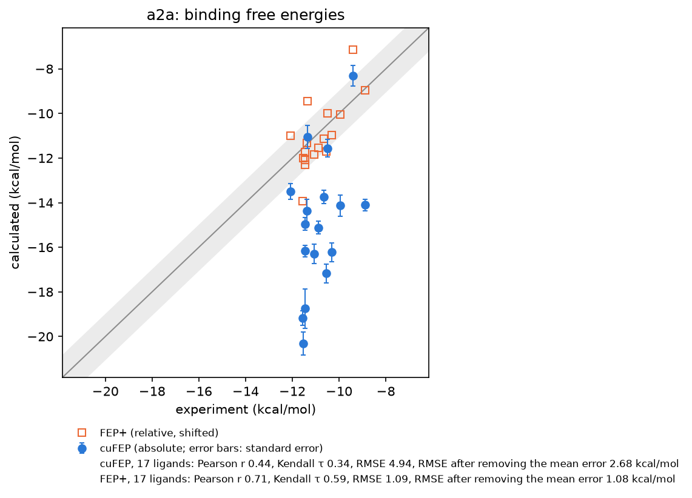
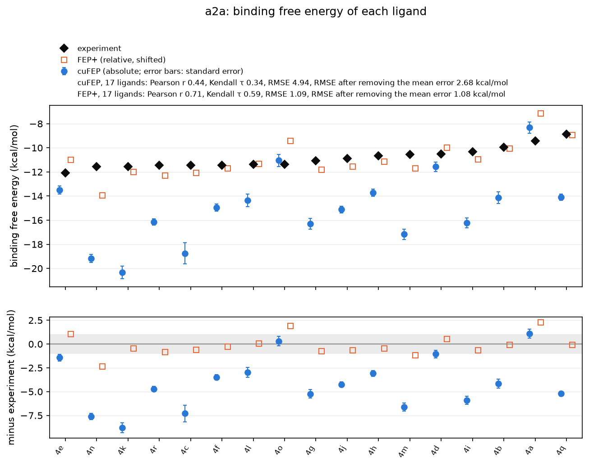

# Accuracy of cuFEP against experiment and FEP+

[日本語](https://github.com/ytworks/cuFEP/wiki/Accuracy-ja)

This page reports how close the absolute binding free energies of cuFEP come to experiment, side
by side with the FEP+ predictions published with the same benchmark sets. Every number comes from
one run of each full set, recorded in the repository under
[benchmarks/results](https://github.com/ytworks/cuFEP/tree/main/benchmarks/results). Nothing was
left out, rerun or adjusted after the run: ligands whose result did not pass a check of the
analysis are compared like all others, and marked. The page gives numbers, not verdicts.

- [Summary](#summary)
- [What was calculated](#what-was-calculated)
- [The reference data](#the-reference-data)
- [How to read the comparison](#how-to-read-the-comparison)
- [TYK2](#tyk2)
- [A2A](#a2a)
- [Comparison with Felis, another ABFE method](#comparison-with-felis-another-abfe-method)
- [Compared with the earlier run](#compared-with-the-earlier-run)
- [What these results do not say](#what-these-results-do-not-say)
- [Reproducing the results](#reproducing-the-results)
- [Sources](#sources)

## Summary

One calculation per ligand, 5 ns of production per lambda window, on the full TYK2 (16 ligands)
and A2A (17 compounds) sets. The statistics below are those of the Felis paper's definitions (see
[Comparison with Felis](#comparison-with-felis-another-abfe-method)), so that all three methods
are computed the same way (kcal/mol; offset b = <experiment - prediction>). The FEP+ values were
shifted as a whole to the experimental mean of the published set, so their offset is near zero by
construction and is not comparable with the offsets of the two absolute methods:

| set | method | R^2 | Spearman rho | Kendall tau | offset b | RMSE after offset |
|---|---|---|---|---|---|---|
| TYK2 (16) | cuFEP, 5 ns x 1 | 0.35 | 0.65 | 0.47 | 1.20 | 1.25 |
| TYK2 (16) | Felis, 5 ns x 3 | 0.69 | 0.82 | 0.68 | 0.04 | 0.82 |
| TYK2 (16) | FEP+ | 0.86 | 0.93 | 0.81 | 0.00 | 0.47 |
| A2A (17) | cuFEP, 5 ns x 1 | 0.19 | 0.43 | 0.34 | 4.14 | 2.68 |
| A2A (17) | Felis, 5 ns x 3 | 0.55 | 0.81 | 0.65 | 2.74 | 1.16 |
| A2A (17) | FEP+ | 0.50 | 0.73 | 0.59 | 0.16 | 1.08 |

- On both sets cuFEP ranks the ligands less well than FEP+ and Felis, and its error after
  removing the offset is larger.
- cuFEP's predictions are more strongly bound than experiment by 1.20 kcal/mol on average for
  TYK2 and by 4.14 for A2A; Felis's are by 0.04 and 2.74.
- All 66 legs ran adaptive lambda scheduling (the complex legs from 30 lambda windows, by the
  overlap of two neighbouring windows alone with the threshold 0.30; the solvent legs by the
  overlap matrix of a stage with 0.18) and no result is NOT RELIABLE. 12 of the 16 TYK2 ligands
  and 14 of the 17 A2A compounds have a leg with a lambda window of fewer than 50 independent
  samples.
- An earlier run of both sets, with the defaults cuFEP had before, is put beside this one in
  [Compared with the earlier run](#compared-with-the-earlier-run): ligand by ligand the two runs
  differ by -3.76 to +2.27 kcal/mol (TYK2) and by -4.78 to +5.41 (A2A); the standard errors of
  the single calculations are 0.26 to 1.02.

## What was calculated

cuFEP version 0.1 at commit `e77a6c5` (`main` after pull request #7), run on 22 November 2026
from a Docker image built from that commit on one machine with eight GPUs, with NVIDIA's
cuPotential plugin for OpenMM as the compute backend (all 66 legs ran on it). Each set ran with
the settings of its example
([examples/kinase_tyk2/config.yaml](https://github.com/ytworks/cuFEP/blob/main/examples/kinase_tyk2/config.yaml),
[examples/membrane_a2a/config.yaml](https://github.com/ytworks/cuFEP/blob/main/examples/membrane_a2a/config.yaml)),
one calculation per ligand. Every setting and its basis is in
[docs/configuration.md](https://github.com/ytworks/cuFEP/blob/main/docs/configuration.md); the
method is in [docs/protocol.md](https://github.com/ytworks/cuFEP/blob/main/docs/protocol.md).

| setting | value |
|---|---|
| method | absolute binding free energy by double decoupling; Boresch restraints, anchor atoms chosen from the protein-ligand interactions of unrestrained MD of the complex (`restraints.selection: interactions`, the default: four runs of 3 ns from the input pose, the last 2 ns of each analysed, 800 frames) |
| force fields | ff14SB (protein), TIP3P (water), OpenFF 2.2.1 with AM1-BCC charges (ligand), Lipid21 POPC (the A2A bilayer) |
| conditions | 298.15 K, 1 bar, ionic strength 0.15 M; time step 4 fs with hydrogen mass repartitioning (3 amu) |
| before the alchemical run | complex leg 0.25 ns NVT, 0.5 ns NPT and 5 ns of MD; solvent leg 0.1, 0.2 and 0.5 ns; A2A: 10 ns of equilibration of the bilayer |
| lambda windows | adaptive lambda scheduling (Midgley et al. 2025). Complex leg: from 30 windows (restrain 6, discharge 11, vanish 15), a window added where two neighbouring windows alone overlap by 0.30 or less. Solvent leg: from 5 and 9 windows, threshold 0.18 of the overlap matrix of a stage. These are the defaults |
| sampling | Hamiltonian replica exchange, 2.5 ps per iteration; REST2 on the ligand and the residues within 0.4 nm of it, scale 1.5 |
| per lambda window | 1 ns of equilibration and 5 ns of production (the default of cuFEP is 10 ns; the examples and the benchmarks set 5 ns) |
| analysis | MBAR minus the long-range dispersion correction; standard error from blocks of time, not below the analytical one (the analytical one where too few samples allow no blocks); version 10 of the analysis |

## The reference data

The sets come from the Schrödinger public binding free energy benchmark (Ross et al. 2023, MIT
licence); cuFEP uses its input files unmodified
([benchmarks/README.md](https://github.com/ytworks/cuFEP/blob/main/benchmarks/README.md)).

| set | target | ligands | experimental range (kcal/mol) | source of the set |
|---|---|---|---|---|
| `tyk2` (`jacs_set/tyk2`) | TYK2 kinase (PDB 4GIH), in water | 16 | -11.70 to -7.42 (4.28) | doi:10.1021/ja512751q |
| `a2a` (`gpcrs/a2a_hip278`) | adenosine A2A receptor (PDB 5OLZ), in a POPC bilayer | 17 compounds | -12.07 to -8.89 (3.19) | doi:10.1021/acs.jcim.0c00449 |

- Experiment: the experimental binding free energy of each ligand given with the set (`r_exp_dg`
  in its SDF, the same as `Exp. dG` in the FEP+ results file).
- FEP+: `Pred. dG` of the FEP+ results file published with the set (`tyk2_out.csv`; for A2A
  `a2a_hip278_sbpkacorr_out.csv`). These come from relative calculations over a map of
  perturbations, shifted as a whole to the experimental mean of the published set. They are taken
  as published; FEP+ was not run for this page.
- The states of the ligands: TYK2 has one neutral record per compound. The A2A source holds 29
  records for its 17 compounds (rotamers, enantiomers, deprotonated forms); cuFEP 0.1 treats
  neutral ligands only, and the record used is the one the FEP+ results file reports, which is
  neutral for every compound
  ([benchmarks/a2a/ligands.csv](https://github.com/ytworks/cuFEP/blob/main/benchmarks/a2a/ligands.csv)).

## How to read the comparison

- cuFEP computes absolute binding free energies; the FEP+ values are relative ones shifted to the
  experimental mean. The raw mean signed error, RMSE and MUE of cuFEP therefore include any
  offset common to all its values, while those of FEP+ have the offset removed by the shift (over
  the whole published set their mean signed error is zero; over the ligands here it need not be).
  These three rows are not like for like. The rows that compare the two methods like for like are
  the RMSE after removing each method's mean error, the pairwise ddG RMSE, Kendall tau, Spearman
  rho, Pearson r and Pearson R^2.
- The values in brackets are 95 % bootstrap intervals over ligands (2000 resamples). With 16 and
  17 ligands they are wide.
- The error bar of a cuFEP value is the standard error of the one calculation, from blocks of
  time common to all lambda windows and not below the analytical one; where a leg has too few
  samples for blocks, the analytical one (1 of the 16 TYK2 ligands, 8 of the 17 A2A compounds). Repeated calculations of the same complex leg have differed
  among themselves by more than this standard error
  ([protocol: REST2](https://github.com/ytworks/cuFEP/blob/main/docs/protocol.md#rest2)), so the
  error bars understate how much a second run could differ.
- Two checks of the literature are made on every leg. NOT RELIABLE: two neighbouring lambda
  windows overlap by less than 0.03 (Klimovich et al. 2015). Few independent samples: a lambda
  window gives MBAR fewer than 50 uncorrelated samples (Mey et al. 2020). Every ligand with a
  result is in the statistics, NOT RELIABLE ones included; they are drawn as open circles, and a
  second table compares them and the other ligands apart.

## TYK2

16 of 16 ligands have a binding free energy. No ligand is NOT RELIABLE: the lowest overlap of
neighbouring lambda windows is 0.140 to 0.172. In 12 of the 16, a leg has a lambda window with
fewer than 50 independent samples (11 complex legs and 4 solvent legs; the fewest are 11, 12 and
14, in the complex legs of ejm_48, ejm_46 and ejm_45). Adaptive lambda scheduling added 1 to 6
windows to the 30 of each complex leg (31 to 36 windows) and 3 to 8 to each solvent leg (16 to
21). Every restraint was chosen from the hydrogen bond of the ligand with the backbone of
VAL 981, present in 736 to 782 of the 800 frames analysed.


Statistics over all 16 ligands (kcal/mol; 95 % bootstrap intervals in brackets):

| statistic | cuFEP | FEP+ |
|---|---|---|
| mean signed error (kcal/mol) | -1.20 [-1.83, -0.60] | 0.00 [-0.23, 0.23] |
| RMSE, raw (kcal/mol) | 1.73 [1.10, 2.30] | 0.47 [0.29, 0.65] |
| MUE, raw (kcal/mol) | 1.41 [0.94, 1.93] | 0.37 [0.24, 0.53] |
| RMSE after removing the mean error (kcal/mol) | 1.25 [0.75, 1.62] | 0.47 [0.28, 0.63] |
| pairwise ddG RMSE (kcal/mol) | 1.83 [1.10, 2.36] | 0.69 [0.41, 0.92] |
| Kendall tau | 0.47 [0.12, 0.75] | 0.81 [0.61, 0.96] |
| Spearman rho | 0.65 [0.19, 0.90] | 0.93 [0.75, 0.99] |
| Pearson r | 0.59 [0.15, 0.87] | 0.93 [0.85, 0.98] |
| Pearson R^2 | 0.35 [0.03, 0.75] | 0.86 [0.73, 0.96] |

No ligand is NOT RELIABLE, so there is no second group to compare apart.

Every ligand (kcal/mol; lambda windows of the complex and the solvent leg after adaptive
scheduling; the flags of the checks):

| ligand | experiment | cuFEP | standard error | cuFEP - experiment | FEP+ | FEP+ - experiment | windows complex / solvent | lowest overlap | flags |
|---|---|---|---|---|---|---|---|---|---|
| jmc_23 | -11.70 | -13.36 | 0.30 | -1.66 | -11.27 | +0.43 | 32 / 19 | 0.172 |  |
| ejm_46 | -11.31 | -10.40 | 0.43 | +0.91 | -10.82 | +0.49 | 33 / 17 | 0.153 | few independent samples: complex leg |
| jmc_27 | -11.28 | -12.41 | 0.43 | -1.13 | -11.10 | +0.18 | 33 / 17 | 0.140 | few independent samples: complex leg, solvent leg |
| jmc_28 | -10.98 | -10.39 | 0.63 | +0.59 | -10.34 | +0.64 | 33 / 19 | 0.144 |  |
| jmc_30 | -10.94 | -12.42 | 0.79 | -1.48 | -11.13 | -0.19 | 35 / 17 | 0.159 | few independent samples: complex leg, solvent leg |
| ejm_54 | -10.53 | -13.51 | 0.37 | -2.98 | -10.38 | +0.15 | 34 / 21 | 0.143 | few independent samples: complex leg |
| ejm_42 | -9.78 | -10.62 | 0.34 | -0.84 | -9.95 | -0.17 | 33 / 16 | 0.155 |  |
| ejm_47 | -9.70 | -11.44 | 0.43 | -1.74 | -9.94 | -0.24 | 35 / 17 | 0.146 |  |
| ejm_45 | -9.56 | -12.04 | 0.61 | -2.48 | -9.66 | -0.10 | 33 / 19 | 0.155 | few independent samples: complex leg |
| ejm_31 | -9.54 | -10.08 | 0.37 | -0.54 | -9.91 | -0.37 | 33 / 18 | 0.154 | few independent samples: complex leg |
| ejm_55 | -9.21 | -9.02 | 0.45 | +0.19 | -10.34 | -1.13 | 31 / 19 | 0.153 | few independent samples: complex leg |
| ejm_48 | -9.00 | -10.21 | 0.74 | -1.21 | -8.86 | +0.14 | 34 / 17 | 0.157 | few independent samples: complex leg |
| ejm_50 | -8.98 | -9.08 | 0.54 | -0.10 | -9.40 | -0.42 | 33 / 18 | 0.162 | few independent samples: solvent leg |
| ejm_43 | -8.26 | -9.59 | 0.41 | -1.33 | -8.30 | -0.04 | 35 / 18 | 0.149 | few independent samples: complex leg, solvent leg |
| ejm_49 | -7.75 | -11.84 | 0.57 | -4.09 | -8.05 | -0.30 | 36 / 18 | 0.155 | few independent samples: complex leg |
| ejm_44 | -7.42 | -8.72 | 0.47 | -1.30 | -6.48 | +0.94 | 34 / 17 | 0.153 | few independent samples: complex leg |

What the numbers show, without a verdict:

- 13 of 16 ligands come out more strongly bound than experiment; the mean signed error is -1.20
  kcal/mol.
- The largest deviations are ejm_49 (-4.09), ejm_54 (-2.98), ejm_45 (-2.48), ejm_47 (-1.74) and
  jmc_23 (-1.66).
- The example ligand ejm_31 came out at -10.08 ± 0.37 kcal/mol here. Three calculations of it
  with the same settings, made before this run, gave -9.36, -9.63 and -9.33 (standard deviation
  0.17; [protocol: What was measured on TYK2](https://github.com/ytworks/cuFEP/blob/main/docs/protocol.md#what-was-measured-on-tyk2)).

## A2A

17 of 17 compounds have a binding free energy. No compound is NOT RELIABLE: the lowest overlap of
neighbouring lambda windows is 0.105 to 0.169, 4i's 0.105 being the lowest. In 14 of the 17 the
complex leg has a lambda window with fewer than 50 independent samples, fewer than 14 in four
compounds (4q 4, 4e 5, 4c 12, 4i 13); no solvent leg has one. Adaptive lambda scheduling added 0
to 2 windows to the 30 of each complex leg (30 to 32 windows; 7 complex legs kept the 30) and 3 to
7 to each solvent leg (16 to 20). The restraint was chosen from the hydrogen bond with ASN 253 in
11 compounds, from the stacking with PHE 168 in 5 (4e, 4h, 4i, 4j, 4o) and from the hydrogen bond
with GLU 169 in 1 (4m); the interaction is present in 737 to 797 of the 800 frames analysed.





Statistics over all 17 compounds (kcal/mol; 95 % bootstrap intervals in brackets):

| statistic | cuFEP | FEP+ |
|---|---|---|
| mean signed error (kcal/mol) | -4.14 [-5.36, -2.85] | -0.16 [-0.68, 0.36] |
| RMSE, raw (kcal/mol) | 4.94 [3.82, 5.89] | 1.09 [0.68, 1.43] |
| MUE, raw (kcal/mol) | 4.31 [3.20, 5.40] | 0.84 [0.53, 1.18] |
| RMSE after removing the mean error (kcal/mol) | 2.68 [1.76, 3.24] | 1.08 [0.58, 1.40] |
| pairwise ddG RMSE (kcal/mol) | 3.91 [2.56, 4.72] | 1.58 [0.85, 2.05] |
| Kendall tau | 0.34 [-0.03, 0.67] | 0.59 [0.28, 0.86] |
| Spearman rho | 0.43 [-0.07, 0.82] | 0.73 [0.35, 0.95] |
| Pearson r | 0.44 [-0.02, 0.77] | 0.71 [0.28, 0.90] |
| Pearson R^2 | 0.19 [0.00, 0.60] | 0.50 [0.08, 0.81] |

No compound is NOT RELIABLE, so there is no second group to compare apart.

Every compound (kcal/mol; lambda windows of the complex and the solvent leg after adaptive
scheduling; the flags of the checks):

| ligand | experiment | cuFEP | standard error | cuFEP - experiment | FEP+ | FEP+ - experiment | windows complex / solvent | lowest overlap | flags |
|---|---|---|---|---|---|---|---|---|---|
| 4e | -12.07 | -13.50 | 0.34 | -1.43 | -11.01 | +1.06 | 30 / 17 | 0.169 | few independent samples: complex leg |
| 4n | -11.55 | -19.17 | 0.33 | -7.62 | -13.93 | -2.38 | 31 / 17 | 0.147 | few independent samples: complex leg |
| 4k | -11.54 | -20.32 | 0.52 | -8.78 | -12.00 | -0.46 | 31 / 18 | 0.148 | few independent samples: complex leg |
| 4r | -11.46 | -16.17 | 0.26 | -4.70 | -12.31 | -0.85 | 31 / 17 | 0.151 |  |
| 4c | -11.46 | -18.75 | 0.88 | -7.29 | -12.09 | -0.63 | 30 / 17 | 0.145 | few independent samples: complex leg |
| 4f | -11.45 | -14.96 | 0.29 | -3.51 | -11.72 | -0.27 | 32 / 18 | 0.160 | few independent samples: complex leg |
| 4l | -11.38 | -14.37 | 0.52 | -2.99 | -11.32 | +0.06 | 31 / 20 | 0.150 | few independent samples: complex leg |
| 4o | -11.36 | -11.05 | 0.51 | +0.31 | -9.44 | +1.92 | 31 / 19 | 0.158 | few independent samples: complex leg |
| 4g | -11.06 | -16.30 | 0.45 | -5.23 | -11.83 | -0.77 | 30 / 18 | 0.147 | few independent samples: complex leg |
| 4j | -10.89 | -15.12 | 0.28 | -4.23 | -11.54 | -0.65 | 31 / 17 | 0.150 | few independent samples: complex leg |
| 4h | -10.65 | -13.74 | 0.30 | -3.08 | -11.13 | -0.48 | 30 / 16 | 0.145 |  |
| 4m | -10.55 | -17.17 | 0.42 | -6.62 | -11.71 | -1.16 | 31 / 19 | 0.152 | few independent samples: complex leg |
| 4d | -10.51 | -11.56 | 0.39 | -1.06 | -9.98 | +0.53 | 31 / 18 | 0.145 | few independent samples: complex leg |
| 4i | -10.31 | -16.22 | 0.41 | -5.91 | -10.97 | -0.66 | 30 / 17 | 0.105 | few independent samples: complex leg |
| 4b | -9.96 | -14.13 | 0.47 | -4.17 | -10.06 | -0.10 | 30 / 18 | 0.145 |  |
| 4a | -9.41 | -8.32 | 0.46 | +1.09 | -7.15 | +2.26 | 31 / 18 | 0.142 | few independent samples: complex leg |
| 4q | -8.89 | -14.11 | 0.27 | -5.22 | -8.96 | -0.07 | 30 / 18 | 0.151 | few independent samples: complex leg |

What the numbers show, without a verdict:

- 15 of 17 compounds come out more strongly bound than experiment; the mean signed error over all
  17 is -4.14 kcal/mol. The Felis paper reports an offset in the same direction for this target,
  of 2.74.
- The largest deviations are 4k (-8.78), 4n (-7.62), 4c (-7.29), 4m (-6.62) and 4i (-5.91).
- The example ligand 4e came out at -13.50 ± 0.34 kcal/mol here (complex leg 39.76, solvent leg
  16.54). Single calculations of it with earlier versions gave -18.91 and -11.95 with the
  restraint chosen by `restraints.selection: auto`, and -12.14, -16.85 and -15.47 with
  `interactions` and other starts of the MD for the restraint.
- Between the last two quarters of the 10 ns of equilibration of the bilayer, its area changed
  by -2.2 to +0.6 % and the number of water molecules near the ligand by -0.3 to +0.8, over the
  17 complex legs.

## Comparison with Felis, another ABFE method

Felis (ByteDance Seed) computes absolute binding free energies on OpenMM and was benchmarked on
the same public sets (Ding et al., arXiv:2603.22274, version 3 of 9 November 2026). Its per-ligand
values are not published, so the comparison is made per target, with the statistics as that paper
defines them: R^2 (Pearson), Spearman rho, Kendall tau, the offset b = <experiment - prediction>,
the RMSE and MAE of the predictions shifted by b, and the fraction of correctly ranked pairs among
those whose experimental values differ by more than 2 kcal/mol. The cuFEP and FEP+ rows are
computed here by those definitions; applied to the published FEP+ predictions they give the FEP+
rows of the paper exactly, for both targets. The Felis rows are copied from the paper.

| | cuFEP (this page) | Felis (the paper) |
|---|---|---|
| calculations per ligand | 1 calculation | 3 calculations, averaged |
| lambda states, complex / solvent | adaptive: TYK2 31-36 / 16-21, A2A 30-32 / 16-20 | 80 / 24 for neutral ligands (96 / 32 for charged ones) |
| Boresch restraint | anchor atoms from the protein-ligand interactions of four unrestrained MD runs of 3 ns of the complex (the rule of the Felis paper, section 2.1) | anchor atoms from the protein-ligand interactions of four unrestrained MD runs of 3 ns of the complex |
| sampling per state | 5 ns after 1 ns of equilibration | 5 ns (or its first 3 ns), nothing discarded |
| enhanced sampling | Hamiltonian replica exchange, REST2 on the pocket | Hamiltonian replica exchange, RelocationMC for water near the ligand |
| ligand force field | OpenFF 2.2.1, AM1-BCC | ByteFF25, AM1-BCC (or ABCG2) |
| estimator | MBAR | BAR between neighbouring states |
| states of a ligand | one record per compound: for A2A the neutral record that the FEP+ results file reports (17 of the 29 records) | every record of the benchmark (alternative poses and protonation states, 998 configurations for 857 entries), combined per compound with symmetry and pKa/tautomer corrections |
| crystallographic waters | those in the input; the TYK2 and A2A protein files used here hold none | kept as provided in the benchmark repository |
| A2A environment | the receptor in a POPC bilayer built by cuFEP | not described in the paper |

TYK2:

| method | ligands | R^2 | Spearman rho | Kendall tau | offset b | RMSE after offset | MAE after offset | correct order ratio |
|---|---|---|---|---|---|---|---|---|
| cuFEP, this run (5 ns x 1) | 16 | 0.35 | 0.65 | 0.47 | 1.20 | 1.25 | 0.94 | 0.91 |
| FEP+, computed here from the published predictions | 16 | 0.86 | 0.93 | 0.81 | 0.00 | 0.47 | 0.37 | 1.00 |
| Felis, 5 ns x 3, ByteFF25 AM1-BCC |  | 0.69 | 0.82 | 0.68 | 0.04 | 0.82 | 0.56 | 0.97 |
| Felis, 3 ns x 3, ByteFF25 AM1-BCC |  | 0.64 | 0.83 | 0.67 | 0.23 | 0.89 | 0.64 | 0.97 |
| Felis, 5 ns x 3, ByteFF25 ABCG2 |  | 0.39 | 0.66 | 0.48 | 0.09 | 1.06 | 0.76 | 0.91 |
| FEP+ as the paper gives it |  | 0.86 | 0.93 | 0.81 | 0.00 | 0.47 | 0.37 | 1.00 |

A2A:

| method | ligands | R^2 | Spearman rho | Kendall tau | offset b | RMSE after offset | MAE after offset | correct order ratio |
|---|---|---|---|---|---|---|---|---|
| cuFEP, this run (5 ns x 1) | 17 | 0.19 | 0.43 | 0.34 | 4.14 | 2.68 | 2.16 | 0.81 |
| FEP+, computed here from the published predictions | 17 | 0.50 | 0.73 | 0.59 | 0.16 | 1.08 | 0.79 | 1.00 |
| Felis, 5 ns x 3, ByteFF25 AM1-BCC |  | 0.55 | 0.81 | 0.65 | 2.74 | 1.16 | 0.88 | 1.00 |
| Felis, 3 ns x 3, ByteFF25 AM1-BCC |  | 0.53 | 0.75 | 0.57 | 2.98 | 1.20 | 0.92 | 1.00 |
| Felis, 5 ns x 3, ByteFF25 ABCG2 |  | 0.57 | 0.87 | 0.72 | 2.04 | 1.07 | 0.75 | 0.94 |
| FEP+ as the paper gives it |  | 0.50 | 0.73 | 0.59 | 0.16 | 1.08 | 0.79 | 1.00 |

## Compared with the earlier run

Both sets were run once before, at commit `3b45bfe` (pull request #4; its record:
[benchmarks/results at commit cda6965](https://github.com/ytworks/cuFEP/tree/cda6965/benchmarks/results)).
The code of cuFEP changed between the two commits; the recorded settings of the two runs
(`resolved_config.yaml`) differ only in those of this table:

| setting | earlier run (3b45bfe) | this run (e77a6c5) |
|---|---|---|
| Boresch restraint, `restraints.selection` | `auto`: anchor atoms from the pre-equilibration | `interactions`: anchor atoms from the protein-ligand interactions of unrestrained MD of the complex |
| adaptive lambda scheduling of the complex leg | from 3, 5 and 9 windows; threshold 0.18 of the overlap matrix of a stage | from 30 windows; threshold 0.30 of the overlap of two neighbouring windows alone |
| largest number of lambda windows, complex / solvent | 48 / 32 | 100 / 100 |

The complex legs ended with 20 to 30 (TYK2) and 17 to 21 (A2A) lambda windows in the earlier run
and with 31 to 36 and 30 to 32 in this one; no leg reached the largest number.

The statistics of both runs, by the definitions of the Felis paper (kcal/mol):

| set | run | R^2 | Spearman rho | Kendall tau | offset b | RMSE after offset | MAE after offset | correct order ratio |
|---|---|---|---|---|---|---|---|---|
| TYK2 (16) | this run (e77a6c5) | 0.35 | 0.65 | 0.47 | 1.20 | 1.25 | 0.94 | 0.91 |
| TYK2 (16) | earlier run (3b45bfe) | 0.19 | 0.21 | 0.12 | 0.62 | 1.74 | 1.49 | 0.68 |
| A2A (17) | this run (e77a6c5) | 0.19 | 0.43 | 0.34 | 4.14 | 2.68 | 2.16 | 0.81 |
| A2A (17) | earlier run (3b45bfe) | 0.15 | 0.48 | 0.38 | 4.12 | 2.26 | 1.79 | 0.94 |

Every ligand in both runs (kcal/mol; a standard error is that of the one calculation):

TYK2 (16):

| ligand | experiment | this run | standard error | earlier run | standard error | this run - earlier run |
|---|---|---|---|---|---|---|
| jmc_23 | -11.70 | -13.36 | 0.30 | -9.60 | 0.37 | -3.76 |
| ejm_46 | -11.31 | -10.40 | 0.43 | -11.26 | 0.48 | +0.86 |
| jmc_27 | -11.28 | -12.41 | 0.43 | -9.48 | 0.52 | -2.92 |
| jmc_28 | -10.98 | -10.39 | 0.63 | -9.76 | 0.33 | -0.63 |
| jmc_30 | -10.94 | -12.42 | 0.79 | -14.69 | 0.91 | +2.27 |
| ejm_54 | -10.53 | -13.51 | 0.37 | -12.47 | 0.57 | -1.04 |
| ejm_42 | -9.78 | -10.62 | 0.34 | -11.97 | 0.41 | +1.35 |
| ejm_47 | -9.70 | -11.44 | 0.43 | -9.41 | 0.31 | -2.03 |
| ejm_45 | -9.56 | -12.04 | 0.61 | -10.43 | 0.48 | -1.61 |
| ejm_31 | -9.54 | -10.08 | 0.37 | -9.84 | 0.33 | -0.24 |
| ejm_55 | -9.21 | -9.02 | 0.45 | -10.23 | 0.46 | +1.21 |
| ejm_48 | -9.00 | -10.21 | 0.74 | -10.72 | 0.36 | +0.51 |
| ejm_50 | -8.98 | -9.08 | 0.54 | -11.04 | 0.54 | +1.96 |
| ejm_43 | -8.26 | -9.59 | 0.41 | -8.21 | 0.41 | -1.38 |
| ejm_49 | -7.75 | -11.84 | 0.57 | -11.07 | 0.60 | -0.77 |
| ejm_44 | -7.42 | -8.72 | 0.47 | -5.73 | 0.36 | -2.99 |

A2A (17):

| ligand | experiment | this run | standard error | earlier run | standard error | this run - earlier run |
|---|---|---|---|---|---|---|
| 4e | -12.07 | -13.50 | 0.34 | -18.91 | 0.52 | +5.41 |
| 4n | -11.55 | -19.17 | 0.33 | -18.50 | 0.65 | -0.67 |
| 4k | -11.54 | -20.32 | 0.52 | -15.54 | 0.34 | -4.78 |
| 4r | -11.46 | -16.17 | 0.26 | -16.43 | 0.63 | +0.26 |
| 4c | -11.46 | -18.75 | 0.88 | -15.14 | 0.72 | -3.61 |
| 4f | -11.45 | -14.96 | 0.29 | -14.52 | 0.38 | -0.43 |
| 4l | -11.38 | -14.37 | 0.52 | -13.82 | 0.65 | -0.55 |
| 4o | -11.36 | -11.05 | 0.51 | -10.19 | 0.85 | -0.86 |
| 4g | -11.06 | -16.30 | 0.45 | -13.57 | 0.69 | -2.72 |
| 4j | -10.89 | -15.12 | 0.28 | -14.63 | 0.47 | -0.49 |
| 4h | -10.65 | -13.74 | 0.30 | -18.36 | 1.02 | +4.62 |
| 4m | -10.55 | -17.17 | 0.42 | -16.30 | 0.30 | -0.88 |
| 4d | -10.51 | -11.56 | 0.39 | -13.30 | 0.34 | +1.74 |
| 4i | -10.31 | -16.22 | 0.41 | -15.41 | 0.66 | -0.81 |
| 4b | -9.96 | -14.13 | 0.47 | -16.68 | 0.62 | +2.54 |
| 4a | -9.41 | -8.32 | 0.46 | -10.15 | 0.45 | +1.83 |
| 4q | -8.89 | -14.11 | 0.27 | -13.09 | 0.36 | -1.02 |

What the numbers show, without a verdict:

- Each run is one calculation per ligand, and the two runs differ in two settings at once. Ligand
  by ligand they differ by -3.76 to +2.27 kcal/mol for TYK2 (mean absolute difference 1.60) and
  by -4.78 to +5.41 for A2A (1.95).
- How much one calculation varies was measured on the TYK2 example ligand ejm_31 alone: four
  calculations with `interactions` and the earlier start of the complex leg had a standard
  deviation of 2.09 kcal/mol, three with the present start 0.17
  ([protocol: What was measured on TYK2](https://github.com/ytworks/cuFEP/blob/main/docs/protocol.md#what-was-measured-on-tyk2)).
  For the other ligands and for A2A it has not been measured, so a difference between the two
  runs does not by itself show the effect of either setting.

## What these results do not say

- One calculation per ligand: a second run of the same set gives other numbers, within the spread
  described above. MD on GPUs is not reproducible to the bit.
- Two targets and 33 ligands: the intervals are wide, and the narrow experimental range of A2A
  leaves little room for rank correlations.
- The FEP+ values come from another force field and protocol and from relative calculations;
  differences between the two methods mix force field, sampling and protocol.
- Nothing here concerns charged ligands, cofactors or other targets. The page gives no run times
  ([docs/LICENSING.md](https://github.com/ytworks/cuFEP/blob/main/docs/LICENSING.md)).

## Reproducing the results

With the image built from the commit above (`docker/Dockerfile`), on all GPUs of the machine:

```bash
cufep benchmark run tyk2 --tier full -o runs/benchmark_tyk2_full
cufep benchmark run a2a --tier full -o runs/benchmark_a2a_full
cufep benchmark report tyk2 runs/benchmark_tyk2_full
cufep benchmark report a2a runs/benchmark_a2a_full
```

The report writes `benchmark_report.md`, `benchmark_report.csv`, `benchmark_report.png` and
`benchmark_report_ligands.png` into the run directory; the recorded ones are in
[benchmarks/results](https://github.com/ytworks/cuFEP/tree/main/benchmarks/results).

## Sources

- Ross et al., "The maximal and current accuracy of rigorous protein-ligand binding free energy
  calculations", Commun. Chem. 2023, 6, 222; the benchmark:
  https://github.com/schrodinger/public_binding_free_energy_benchmark (MIT licence).
- The sources of the two sets, as the benchmark gives them: doi:10.1021/ja512751q (TYK2) and
  doi:10.1021/acs.jcim.0c00449 (A2A).
- Klimovich, Shirts and Mobley, "Guidelines for the analysis of free energy calculations",
  J. Comput. Aided Mol. Des. 2015, 29, 397.
- Mey et al., "Best Practices for Alchemical Free Energy Calculations", Living J. Comput. Mol.
  Sci. 2020, 2, 18378.
- Ding, Liu, Wang, Xia, Wang and Yan, "Development and large-scale benchmarks of a protein-ligand
  absolute binding free energy toolkit", arXiv:2603.22274 (version 3, 9 November 2026);
  https://github.com/ByteDance-Seed/felis.
- Midgley, Bariami, Habgood and Mackey, "Adaptive Lambda Scheduling: A Method for Computational
  Efficiency in Free Energy Perturbation Simulations", J. Chem. Inf. Model. 2025, 65, 512.
