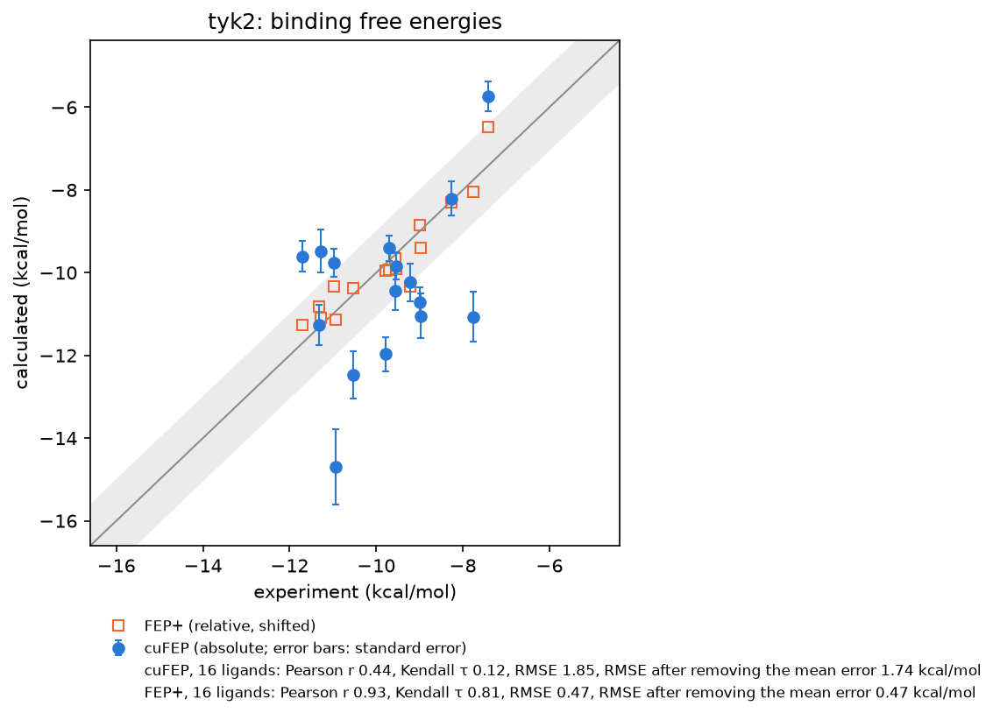
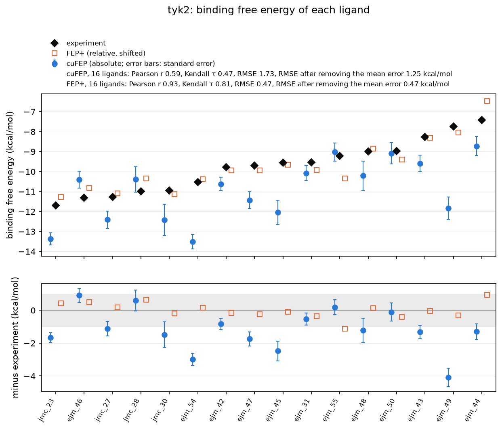

# Accuracy of cuFEP against experiment and FEP+

[日本語](https://github.com/ytworks/cuFEP/wiki/Accuracy-ja)

This page reports how close the absolute binding free energies of cuFEP come to experiment, side
by side with the FEP+ predictions published with the same benchmark sets. Every number comes from
one run of each full set, recorded in the repository under
[benchmarks/results](https://github.com/ytworks/cuFEP/tree/main/benchmarks/results). Nothing was
left out, rerun or adjusted after the run: ligands whose result did not pass a check of the
analysis are compared like all others, and marked. The page gives numbers, not verdicts.

- [Summary](#summary)
- [What was calculated](#what-was-calculated)
- [The reference data](#the-reference-data)
- [How to read the comparison](#how-to-read-the-comparison)
- [TYK2](#tyk2)
- [A2A](#a2a)
- [Comparison with Felis, another ABFE method](#comparison-with-felis-another-abfe-method)
- [What these results do not say](#what-these-results-do-not-say)
- [Reproducing the results](#reproducing-the-results)
- [Sources](#sources)

## Summary

One calculation per ligand, 5 ns of production per lambda window, on the full TYK2 (16 ligands)
and A2A (17 compounds) sets. The statistics below are those of the Felis paper's definitions (see
[Comparison with Felis](#comparison-with-felis-another-abfe-method)), so that all three methods
are computed the same way (kcal/mol; offset b = <experiment - prediction>). The FEP+ values were
shifted as a whole to the experimental mean of the published set, so their offset is near zero by
construction and is not comparable with the offsets of the two absolute methods:

| set | method | R^2 | Spearman rho | Kendall tau | offset b | RMSE after offset |
|---|---|---|---|---|---|---|
| TYK2 (16) | cuFEP, 5 ns x 1 | 0.19 | 0.21 | 0.12 | 0.62 | 1.74 |
| TYK2 (16) | Felis, 5 ns x 3 | 0.69 | 0.82 | 0.68 | 0.04 | 0.82 |
| TYK2 (16) | FEP+ | 0.86 | 0.93 | 0.81 | 0.00 | 0.47 |
| A2A (17) | cuFEP, 5 ns x 1 | 0.15 | 0.48 | 0.38 | 4.12 | 2.26 |
| A2A (17) | Felis, 5 ns x 3 | 0.55 | 0.81 | 0.65 | 2.74 | 1.16 |
| A2A (17) | FEP+ | 0.50 | 0.73 | 0.59 | 0.16 | 1.08 |

- On both sets cuFEP ranks the ligands less well than FEP+ and Felis, and its error after
  removing the offset is larger.
- cuFEP's predictions are more strongly bound than experiment by 0.62 kcal/mol on average for
  TYK2 and by 4.12 for A2A; Felis's are by 0.04 and 2.74.
- All 66 legs ran adaptive lambda scheduling with the threshold 0.18 and no result is NOT
  RELIABLE. 12 of the 16 TYK2 ligands and 16 of the 17 A2A compounds have a leg with a lambda
  window of fewer than 50 independent samples.
- Two calculations of the A2A example ligand 4e with the same settings gave -11.95 and -18.91
  kcal/mol (see [A2A](#a2a)): one calculation of cuFEP varies by more than its standard error.

## What was calculated

cuFEP version 0.1 at commit `3b45bfe` (pull request #4), run from a Docker image built from that
commit on one machine with eight GPUs, with NVIDIA's cuPotential plugin for OpenMM as the compute
backend. Each set ran with the settings of its example
([examples/kinase_tyk2/config.yaml](https://github.com/ytworks/cuFEP/blob/main/examples/kinase_tyk2/config.yaml),
[examples/membrane_a2a/config.yaml](https://github.com/ytworks/cuFEP/blob/main/examples/membrane_a2a/config.yaml)),
one calculation per ligand. Every setting and its basis is in
[docs/configuration.md](https://github.com/ytworks/cuFEP/blob/main/docs/configuration.md); the
method is in [docs/protocol.md](https://github.com/ytworks/cuFEP/blob/main/docs/protocol.md).

| setting | value |
|---|---|
| method | absolute binding free energy by double decoupling; Boresch restraints, anchor atoms chosen automatically |
| force fields | ff14SB (protein), TIP3P (water), OpenFF 2.2.1 with AM1-BCC charges (ligand), Lipid21 POPC (the A2A bilayer) |
| conditions | 298.15 K, 1 bar, ionic strength 0.15 M; time step 4 fs with hydrogen mass repartitioning (3 amu) |
| before the alchemical run | complex leg 0.25 ns NVT, 0.5 ns NPT and 5 ns of MD; solvent leg 0.1, 0.2 and 0.5 ns; A2A: 10 ns of equilibration of the bilayer |
| lambda windows | adaptive lambda scheduling (Midgley et al. 2025), threshold 0.18 |
| sampling | Hamiltonian replica exchange, 2.5 ps per iteration; REST2 on the ligand and the residues within 0.4 nm of it, scale 1.5 |
| per lambda window | 1 ns of equilibration and 5 ns of production (the default of cuFEP is 10 ns; the examples and the benchmarks set 5 ns) |
| analysis | MBAR minus the long-range dispersion correction; standard error from blocks of time, not below the analytical one (the analytical one where too few samples allow no blocks); version 10 of the analysis |

## The reference data

The sets come from the Schrödinger public binding free energy benchmark (Ross et al. 2023, MIT
licence); cuFEP uses its input files unmodified
([benchmarks/README.md](https://github.com/ytworks/cuFEP/blob/main/benchmarks/README.md)).

| set | target | ligands | experimental range (kcal/mol) | source of the set |
|---|---|---|---|---|
| `tyk2` (`jacs_set/tyk2`) | TYK2 kinase (PDB 4GIH), in water | 16 | -11.70 to -7.42 (4.28) | doi:10.1021/ja512751q |
| `a2a` (`gpcrs/a2a_hip278`) | adenosine A2A receptor (PDB 5OLZ), in a POPC bilayer | 17 compounds | -12.07 to -8.89 (3.19) | doi:10.1021/acs.jcim.0c00449 |

- Experiment: the experimental binding free energy of each ligand given with the set (`r_exp_dg`
  in its SDF, the same as `Exp. dG` in the FEP+ results file).
- FEP+: `Pred. dG` of the FEP+ results file published with the set (`tyk2_out.csv`; for A2A
  `a2a_hip278_sbpkacorr_out.csv`). These come from relative calculations over a map of
  perturbations, shifted as a whole to the experimental mean of the published set. They are taken
  as published; FEP+ was not run for this page.
- The states of the ligands: TYK2 has one neutral record per compound. The A2A source holds 29
  records for its 17 compounds (rotamers, enantiomers, deprotonated forms); cuFEP 0.1 treats
  neutral ligands only, and the record used is the one the FEP+ results file reports, which is
  neutral for every compound
  ([benchmarks/a2a/ligands.csv](https://github.com/ytworks/cuFEP/blob/main/benchmarks/a2a/ligands.csv)).

## How to read the comparison

- cuFEP computes absolute binding free energies; the FEP+ values are relative ones shifted to the
  experimental mean. The raw mean signed error, RMSE and MUE of cuFEP therefore include any
  offset common to all its values, while those of FEP+ have the offset removed by the shift (over
  the whole published set their mean signed error is zero; over the ligands here it need not be).
  These three rows are not like for like. The rows that compare the two methods like for like are
  the RMSE after removing each method's mean error, the pairwise ddG RMSE, Kendall tau, Spearman
  rho, Pearson r and Pearson R^2.
- The values in brackets are 95 % bootstrap intervals over ligands (2000 resamples). With 16 and
  17 ligands they are wide.
- The error bar of a cuFEP value is the standard error of the one calculation, from blocks of
  time common to all lambda windows and not below the analytical one; where a leg has too few
  samples for blocks, the analytical one (5 of the 16 TYK2 ligands, 5 of the 17 A2A compounds). Repeated calculations of the same complex leg have differed
  among themselves by more than this standard error
  ([protocol: REST2](https://github.com/ytworks/cuFEP/blob/main/docs/protocol.md#rest2)), so the
  error bars understate how much a second run could differ.
- Two checks of the literature are made on every leg. NOT RELIABLE: two neighbouring lambda
  windows overlap by less than 0.03 (Klimovich et al. 2015). Few independent samples: a lambda
  window gives MBAR fewer than 50 uncorrelated samples (Mey et al. 2020). Every ligand with a
  result is in the statistics, NOT RELIABLE ones included; they are drawn as open circles, and a
  second table compares them and the other ligands apart.

## TYK2

16 of 16 ligands have a binding free energy. No ligand is NOT RELIABLE: the lowest overlap of
neighbouring lambda windows is 0.139 to 0.180. In 12 of the 16, a leg has a lambda window with
fewer than 50 independent samples. Adaptive lambda scheduling ran with the threshold 0.18 in all
32 legs and added 5 to 15 windows to each complex leg and 4 to 8 to each solvent leg.





Statistics over all 16 ligands (kcal/mol; 95 % bootstrap intervals in brackets):

| statistic | cuFEP | FEP+ |
|---|---|---|
| mean signed error (kcal/mol) | -0.62 [-1.44, 0.29] | 0.00 [-0.23, 0.23] |
| RMSE, raw (kcal/mol) | 1.85 [1.33, 2.34] | 0.47 [0.29, 0.65] |
| MUE, raw (kcal/mol) | 1.52 [1.03, 2.05] | 0.37 [0.24, 0.53] |
| RMSE after removing the mean error (kcal/mol) | 1.74 [1.22, 2.12] | 0.47 [0.28, 0.63] |
| pairwise ddG RMSE (kcal/mol) | 2.55 [1.78, 3.10] | 0.69 [0.41, 0.92] |
| Kendall tau | 0.12 [-0.36, 0.54] | 0.81 [0.61, 0.96] |
| Spearman rho | 0.21 [-0.40, 0.69] | 0.93 [0.75, 0.99] |
| Pearson r | 0.44 [-0.19, 0.77] | 0.93 [0.85, 0.98] |
| Pearson R^2 | 0.19 [0.00, 0.59] | 0.86 [0.73, 0.96] |

No ligand is NOT RELIABLE, so there is no second group to compare apart.

Every ligand (kcal/mol; lambda windows of the complex and the solvent leg after adaptive
scheduling; the flags of the checks):

| ligand | experiment | cuFEP | standard error | cuFEP - experiment | FEP+ | FEP+ - experiment | windows complex / solvent | lowest overlap | flags |
|---|---|---|---|---|---|---|---|---|---|
| jmc_23 | -11.70 | -9.60 | 0.37 | +2.10 | -11.27 | +0.43 | 25 / 17 | 0.145 |  |
| ejm_46 | -11.31 | -11.26 | 0.48 | +0.05 | -10.82 | +0.49 | 22 / 17 | 0.158 | few independent samples: solvent leg |
| jmc_27 | -11.28 | -9.48 | 0.52 | +1.80 | -11.10 | +0.18 | 25 / 17 | 0.154 | few independent samples: solvent leg |
| jmc_28 | -10.98 | -9.76 | 0.33 | +1.22 | -10.34 | +0.64 | 24 / 17 | 0.140 | few independent samples: complex leg |
| jmc_30 | -10.94 | -14.69 | 0.91 | -3.75 | -11.13 | -0.19 | 30 / 18 | 0.164 | few independent samples: solvent leg |
| ejm_54 | -10.53 | -12.47 | 0.57 | -1.94 | -10.38 | +0.15 | 25 / 18 | 0.155 | few independent samples: complex leg |
| ejm_42 | -9.78 | -11.97 | 0.41 | -2.19 | -9.95 | -0.17 | 21 / 20 | 0.139 | few independent samples: solvent leg |
| ejm_47 | -9.70 | -9.41 | 0.31 | +0.29 | -9.94 | -0.24 | 27 / 18 | 0.168 |  |
| ejm_45 | -9.56 | -10.43 | 0.48 | -0.87 | -9.66 | -0.10 | 22 / 18 | 0.170 | few independent samples: complex leg |
| ejm_31 | -9.54 | -9.84 | 0.33 | -0.30 | -9.91 | -0.37 | 20 / 19 | 0.165 | few independent samples: complex leg |
| ejm_55 | -9.21 | -10.23 | 0.46 | -1.02 | -10.34 | -1.13 | 21 / 19 | 0.156 | few independent samples: solvent leg |
| ejm_48 | -9.00 | -10.72 | 0.36 | -1.72 | -8.86 | +0.14 | 24 / 17 | 0.168 |  |
| ejm_50 | -8.98 | -11.04 | 0.54 | -2.06 | -9.40 | -0.42 | 21 / 21 | 0.180 | few independent samples: complex leg |
| ejm_43 | -8.26 | -8.21 | 0.41 | +0.05 | -8.30 | -0.04 | 23 / 18 | 0.166 | few independent samples: solvent leg |
| ejm_49 | -7.75 | -11.07 | 0.60 | -3.32 | -8.05 | -0.30 | 21 / 17 | 0.139 | few independent samples: complex leg, solvent leg |
| ejm_44 | -7.42 | -5.73 | 0.36 | +1.69 | -6.48 | +0.94 | 21 / 20 | 0.162 |  |

What the numbers show, without a verdict:

- The RMSE after removing the mean error, 1.74 kcal/mol, is close to the run-to-run standard
  deviation of one cuFEP binding free energy measured earlier on five TYK2 ligands, three runs
  each: 1.6 kcal/mol, with an earlier version
  ([protocol: Checks of the analysis](https://github.com/ytworks/cuFEP/blob/main/docs/protocol.md#checks-of-the-analysis)).
- The largest deviations are jmc_30 (-3.75), ejm_49 (-3.32), ejm_42 (-2.19), jmc_23 (+2.10) and
  ejm_50 (-2.06).
- The three most strongly binding jmc ligands (jmc_23, jmc_27, jmc_28) come out weaker than
  experiment by 1.2 to 2.1 kcal/mol, which lowers the rank correlation.

## A2A

17 of 17 compounds have a binding free energy. No compound is NOT RELIABLE: the lowest overlap of
neighbouring lambda windows is 0.035 to 0.182, 4e's 0.035 being the closest to the level of 0.03.
In 16 of the 17 the complex leg has a lambda window with fewer than 50 independent samples, as
few as 4 to 13 in eight compounds (4i 4, 4h 6, 4f 9, 4e 10, 4g 10, 4o 11, 4q 11, 4j 13). Adaptive lambda scheduling ran with the threshold 0.18 in
all 34 legs and added 2 to 6 windows to each complex leg and 3 to 7 to each solvent leg.


Statistics over all 17 compounds (kcal/mol; 95 % bootstrap intervals in brackets):

| statistic | cuFEP | FEP+ |
|---|---|---|
| mean signed error (kcal/mol) | -4.12 [-5.15, -3.01] | -0.16 [-0.68, 0.36] |
| RMSE, raw (kcal/mol) | 4.70 [3.73, 5.53] | 1.09 [0.68, 1.43] |
| MUE, raw (kcal/mol) | 4.26 [3.30, 5.19] | 0.84 [0.53, 1.18] |
| RMSE after removing the mean error (kcal/mol) | 2.26 [1.47, 2.85] | 1.08 [0.58, 1.40] |
| pairwise ddG RMSE (kcal/mol) | 3.30 [2.14, 4.15] | 1.58 [0.85, 2.05] |
| Kendall tau | 0.38 [-0.04, 0.74] | 0.59 [0.28, 0.86] |
| Spearman rho | 0.48 [-0.09, 0.85] | 0.73 [0.35, 0.95] |
| Pearson r | 0.39 [-0.19, 0.74] | 0.71 [0.28, 0.90] |
| Pearson R^2 | 0.15 [0.00, 0.55] | 0.50 [0.08, 0.81] |

No compound is NOT RELIABLE, so there is no second group to compare apart.

Every compound (kcal/mol; lambda windows of the complex and the solvent leg after adaptive
scheduling; the flags of the checks):

| ligand | experiment | cuFEP | standard error | cuFEP - experiment | FEP+ | FEP+ - experiment | windows complex / solvent | lowest overlap | flags |
|---|---|---|---|---|---|---|---|---|---|
| 4e | -12.07 | -18.91 | 0.52 | -6.83 | -11.01 | +1.06 | 18 / 17 | 0.035 | few independent samples: complex leg |
| 4n | -11.55 | -18.50 | 0.65 | -6.95 | -13.93 | -2.38 | 20 / 19 | 0.155 | few independent samples: complex leg |
| 4k | -11.54 | -15.54 | 0.34 | -4.00 | -12.00 | -0.46 | 20 / 18 | 0.171 |  |
| 4r | -11.46 | -16.43 | 0.63 | -4.96 | -12.31 | -0.85 | 21 / 18 | 0.166 | few independent samples: complex leg |
| 4c | -11.46 | -15.14 | 0.72 | -3.68 | -12.09 | -0.63 | 18 / 19 | 0.137 | few independent samples: complex leg |
| 4f | -11.45 | -14.52 | 0.38 | -3.08 | -11.72 | -0.27 | 21 / 20 | 0.154 | few independent samples: complex leg |
| 4l | -11.38 | -13.82 | 0.65 | -2.44 | -11.32 | +0.06 | 17 / 17 | 0.140 | few independent samples: complex leg |
| 4o | -11.36 | -10.19 | 0.85 | +1.16 | -9.44 | +1.92 | 18 / 16 | 0.169 | few independent samples: complex leg |
| 4g | -11.06 | -13.57 | 0.69 | -2.51 | -11.83 | -0.77 | 19 / 17 | 0.175 | few independent samples: complex leg |
| 4j | -10.89 | -14.63 | 0.47 | -3.75 | -11.54 | -0.65 | 18 / 17 | 0.121 | few independent samples: complex leg |
| 4h | -10.65 | -18.36 | 1.02 | -7.70 | -11.13 | -0.48 | 17 / 19 | 0.102 | few independent samples: complex leg |
| 4m | -10.55 | -16.30 | 0.30 | -5.75 | -11.71 | -1.16 | 18 / 17 | 0.173 | few independent samples: complex leg |
| 4d | -10.51 | -13.30 | 0.34 | -2.80 | -9.98 | +0.53 | 18 / 18 | 0.182 | few independent samples: complex leg |
| 4i | -10.31 | -15.41 | 0.66 | -5.10 | -10.97 | -0.66 | 18 / 17 | 0.107 | few independent samples: complex leg |
| 4b | -9.96 | -16.68 | 0.62 | -6.72 | -10.06 | -0.10 | 18 / 17 | 0.118 | few independent samples: complex leg |
| 4a | -9.41 | -10.15 | 0.45 | -0.74 | -7.15 | +2.26 | 17 / 18 | 0.115 | few independent samples: complex leg |
| 4q | -8.89 | -13.09 | 0.36 | -4.20 | -8.96 | -0.07 | 18 / 18 | 0.164 | few independent samples: complex leg |

What the numbers show, without a verdict:

- 16 of 17 compounds come out more strongly bound than experiment; the mean signed error over all
  17 is -4.12 kcal/mol. The Felis paper reports an offset in the same direction for this target,
  of 2.74.
- The example ligand 4e came out at -18.91 ± 0.52 kcal/mol here. One calculation with the same
  settings on an earlier commit gave -11.95 ± 0.73. The difference is in the complex leg (44.68
  here, 37.61 then); the solvent leg is the same (16.67, 16.52).
- Between the last two quarters of the 10 ns of equilibration of the bilayer, its area changed by -2.3 to +0.1 % and the number of water molecules near the ligand
  by -1.7 to +1.6, over the 17 complex legs.

## Comparison with Felis, another ABFE method

Felis (ByteDance Seed) computes absolute binding free energies on OpenMM and was benchmarked on
the same public sets (Ding et al., arXiv:2603.22274, version 3 of 9 November 2026). Its per-ligand
values are not published, so the comparison is made per target, with the statistics as that paper
defines them: R^2 (Pearson), Spearman rho, Kendall tau, the offset b = <experiment - prediction>,
the RMSE and MAE of the predictions shifted by b, and the fraction of correctly ranked pairs among
those whose experimental values differ by more than 2 kcal/mol. The cuFEP and FEP+ rows are
computed here by those definitions; applied to the published FEP+ predictions they give the FEP+
rows of the paper exactly, for both targets. The Felis rows are copied from the paper.

| | cuFEP (this page) | Felis (the paper) |
|---|---|---|
| calculations per ligand | 1 calculation | 3 calculations, averaged |
| lambda states, complex / solvent | adaptive: TYK2 20-30 / 17-21, A2A 17-21 / 16-20 | 80 / 24 for neutral ligands (96 / 32 for charged ones) |
| sampling per state | 5 ns after 1 ns of equilibration | 5 ns (or its first 3 ns), nothing discarded |
| enhanced sampling | Hamiltonian replica exchange, REST2 on the pocket | Hamiltonian replica exchange, RelocationMC for water near the ligand |
| ligand force field | OpenFF 2.2.1, AM1-BCC | ByteFF25, AM1-BCC (or ABCG2) |
| estimator | MBAR | BAR between neighbouring states |
| states of a ligand | one record per compound: for A2A the neutral record that the FEP+ results file reports (17 of the 29 records) | every record of the benchmark (alternative poses and protonation states, 998 configurations for 857 entries), combined per compound with symmetry and pKa/tautomer corrections |
| crystallographic waters | those in the input; the TYK2 and A2A protein files used here hold none | kept as provided in the benchmark repository |
| A2A environment | the receptor in a POPC bilayer built by cuFEP | not described in the paper |

TYK2:

| method | ligands | R^2 | Spearman rho | Kendall tau | offset b | RMSE after offset | MAE after offset | correct order ratio |
|---|---|---|---|---|---|---|---|---|
| cuFEP, this run (5 ns x 1) | 16 | 0.19 | 0.21 | 0.12 | 0.62 | 1.74 | 1.49 | 0.68 |
| FEP+, computed here from the published predictions | 16 | 0.86 | 0.93 | 0.81 | 0.00 | 0.47 | 0.37 | 1.00 |
| Felis, 5 ns x 3, ByteFF25 AM1-BCC |  | 0.69 | 0.82 | 0.68 | 0.04 | 0.82 | 0.56 | 0.97 |
| Felis, 3 ns x 3, ByteFF25 AM1-BCC |  | 0.64 | 0.83 | 0.67 | 0.23 | 0.89 | 0.64 | 0.97 |
| Felis, 5 ns x 3, ByteFF25 ABCG2 |  | 0.39 | 0.66 | 0.48 | 0.09 | 1.06 | 0.76 | 0.91 |
| FEP+ as the paper gives it |  | 0.86 | 0.93 | 0.81 | 0.00 | 0.47 | 0.37 | 1.00 |

A2A:

| method | ligands | R^2 | Spearman rho | Kendall tau | offset b | RMSE after offset | MAE after offset | correct order ratio |
|---|---|---|---|---|---|---|---|---|
| cuFEP, this run (5 ns x 1) | 17 | 0.15 | 0.48 | 0.38 | 4.12 | 2.26 | 1.79 | 0.94 |
| FEP+, computed here from the published predictions | 17 | 0.50 | 0.73 | 0.59 | 0.16 | 1.08 | 0.79 | 1.00 |
| Felis, 5 ns x 3, ByteFF25 AM1-BCC |  | 0.55 | 0.81 | 0.65 | 2.74 | 1.16 | 0.88 | 1.00 |
| Felis, 3 ns x 3, ByteFF25 AM1-BCC |  | 0.53 | 0.75 | 0.57 | 2.98 | 1.20 | 0.92 | 1.00 |
| Felis, 5 ns x 3, ByteFF25 ABCG2 |  | 0.57 | 0.87 | 0.72 | 2.04 | 1.07 | 0.75 | 0.94 |
| FEP+ as the paper gives it |  | 0.50 | 0.73 | 0.59 | 0.16 | 1.08 | 0.79 | 1.00 |

## What these results do not say

- One calculation per ligand: a second run of the same set gives other numbers, within the spread
  described above. MD on GPUs is not reproducible to the bit.
- Two targets and 33 ligands: the intervals are wide, and the narrow experimental range of A2A
  leaves little room for rank correlations.
- The FEP+ values come from another force field and protocol and from relative calculations;
  differences between the two methods mix force field, sampling and protocol.
- Nothing here concerns charged ligands, cofactors or other targets. The page gives no run times
  ([docs/LICENSING.md](https://github.com/ytworks/cuFEP/blob/main/docs/LICENSING.md)).

## Reproducing the results

With the image built from the commit above (`docker/Dockerfile`), on all GPUs of the machine:

```bash
cufep benchmark run tyk2 --tier full -o runs/benchmark_tyk2_full
cufep benchmark run a2a --tier full -o runs/benchmark_a2a_full
cufep benchmark report tyk2 runs/benchmark_tyk2_full
cufep benchmark report a2a runs/benchmark_a2a_full
```

The report writes `benchmark_report.md`, `benchmark_report.csv`, `benchmark_report.png` and
`benchmark_report_ligands.png` into the run directory; the recorded ones are in
[benchmarks/results](https://github.com/ytworks/cuFEP/tree/main/benchmarks/results).

## Sources

- Ross et al., "The maximal and current accuracy of rigorous protein-ligand binding free energy
  calculations", Commun. Chem. 2023, 6, 222; the benchmark:
  https://github.com/schrodinger/public_binding_free_energy_benchmark (MIT licence).
- The sources of the two sets, as the benchmark gives them: doi:10.1021/ja512751q (TYK2) and
  doi:10.1021/acs.jcim.0c00449 (A2A).
- Klimovich, Shirts and Mobley, "Guidelines for the analysis of free energy calculations",
  J. Comput. Aided Mol. Des. 2015, 29, 397.
- Mey et al., "Best Practices for Alchemical Free Energy Calculations", Living J. Comput. Mol.
  Sci. 2020, 2, 18378.
- Ding, Liu, Wang, Xia, Wang and Yan, "Development and large-scale benchmarks of a protein-ligand
  absolute binding free energy toolkit", arXiv:2603.22274 (version 3, 9 November 2026);
  https://github.com/ByteDance-Seed/felis.
- Midgley, Bariami, Habgood and Mackey, "Adaptive Lambda Scheduling: A Method for Computational
  Efficiency in Free Energy Perturbation Simulations", J. Chem. Inf. Model. 2025, 65, 512.
